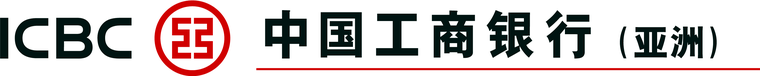

# 香港银行开户总览（内地居民）

{ width="130" }
{ width="130" }
{ width="130" }
{ width="34" }

*以上为四家银行官方标识，来源为各行官网（版权归各行所有，此处仅作识别用途）。*

整理时间 2026-10。来源：各行官网、官方收费表与官方 App 流程说明；少数媒体/第三方整理已单独标注。

> ⚠️ 银行政策与费率调整频繁。本文用于**先想清楚走哪条路**，动手前务必以网点、官网、App 当时的提示为准。
> 本文不构成任何建议，也不涉及任何个人资产或身份规划。

## 先分清三件事

很多人把"开户"当成一件事，其实是三个独立问题：

| 问题 | 决定什么 |
| --- | --- |
| **人在哪** | 决定能走"到港开"还是"内地见证开" |
| **拿什么证件** | 通行证 / 护照 / 香港身份证，决定银行给不给你走 App 自助 |
| **账户级别** | 决定要不要长期锁住一笔钱（最低余额 / 未达标月费） |

## 三条通道

| 通道 | 谁可以走 | 代价 |
| --- | --- | --- |
| **① 到港 + App 自助** | 持往来港澳通行证（EEP）的内地居民 | 得跑一趟香港；门槛低、多为零费用 |
| **② 到港 + 分行柜面** | 所有人 | 要预约、要面谈；部分银行柜面只收高端账户 |
| **③ 内地见证开户** | 有 **3 个月以上**香港长期签注、且以**留学 / 外派 / 务工**为目的者 | 旅游、商务等短期签注**不行** |

**关键分水岭**：见证开户几乎都卡在「**长期签注 + 特定目的**」这两条上。
只持旅游/商务签注的话，②③ 都走不通 —— 只能到港办。

## 四家横向对比

| 项 | 汇丰 HSBC | 中银香港 BOCHK | 工银亚洲 ICBC (Asia) | 恒生 Hang Seng |
| --- | --- | --- | --- | --- |
| 基础账户 | 汇丰 One | 自在理财 / 港币储蓄 | 综合账户 / 理财金账户 | 優進理財 |
| 最低余额要求 | **非香港身份证且 2026-01-01 起新开户：HK$10,000** | 个人储蓄账户低结存费**豁免**¹ | 无公开门槛 | 无 |
| 未达标月费 | HK$100／月（达标可豁免） | 见官方收费表 | — | 優進理財 零月费 |
| 到港 App 自助 | ✅ 支持通行证；**可先在内地提交、90 天内到港激活** | ✅ 但需**人在香港** | ✅ 手机预填 + 到港激活 | ✅ 需人在香港 + 香港本地网络 |
| 内地见证 | 需先有**汇丰中国卓越**（存 50 万 RMB）² | 需 3 个月以上长期签注 | 需 3 个月以上长期签注 **+ 境内工行现有客户** | 恒生中国指定分行 |
| ATM 网络 | 广 | **全港第一** | 工行内地 8 万+ ATM 免手续费 | 全港第一 |

¹ 中银香港官方《一般银行服务收费》表里，港币储蓄/往来账户"每月综合平均结余低于 HK$5,000"的服务月费**注明「只适用于企业客户」，个人客户为豁免**。网上流传的"个人账户 2026 年起收低额结存费"说法**与官方收费表不符**，需以官网收费表 PDF 为准。
² 该条来自第三方整理（xiaowan.hk 等），未在汇丰官网核实。

## 怎么选

| 你的情况 | 建议 |
| --- | --- |
| 只想要一张备用港卡、能跑一趟香港 | **中银香港手机开户**（门槛最低、ATM 最多）或**汇丰 One App 开户** |
| 人暂时去不了香港，但有长期签注 | **工银亚洲见证开户**（要求最明确）或中银香港见证 |
| 去不了香港、也没有长期签注 | 只能走高端路线：汇丰中国卓越（50 万 RMB）→ 远程见证 |
| 想一次性多开几家提高成功率 | 到港后同一天跑 2–3 家：中银 + 汇丰 + 众安/恒生 |

> 💡 **实操建议**：如果只有一次赴港机会，别只申请一家。App 自助开户**不是自动通过**，
> 系统会综合判断身份验证、出入境记录、地址、职业、开户用途与风险信息。

## 通用避坑

1. **第三方"包开户"中介别碰。** 汇丰官网原文：
   > *"Please don't share your information with third parties, or engage with any intermediaries to open an account."*
   恒生官网同样写明「請不要透過任何第三方或中介開立銀行戶口或透露你的敏感個人資料」。
   中介文章常编造门槛（如"50 万资产证明""律师见证费"），**与官网冲突时一律以官网为准**。

2. **"出入境记录"电子档要现开。** 各行要求不同：中银香港要求**申请日起最近 7 日内**由**国家移民局**发出的电子档，逾期作废。微信小程序「国家政务服务平台」可下载。

3. **住址证明有明确排除项。** 通常不接受：转交地址、商业地址、**邮政信箱**、信封；须是 3 个月内、带本人姓名与地址、由**政府机构或公共事务机构**发出。

4. **注意"开户后短期内结清账户"的惩罚性收费。** 例：中银香港个人往来账户开户后 3 个月内结清收 HK$200、储蓄账户 HK$50。

5. **内地见证的时效很硬。** 例：工银亚洲在线填单后须 **14 天内**到受理网点办正式手续，逾期资料自动作废。

6. **不要用美国税务居民身份假设框架。** 若确属美国税务居民（公民／绿卡／通过实质居留测试），部分银行会额外审慎，开户前先致电确认。

## 各家详情

- [中银香港（BOCHK）](bochk-hk-account.md)
- [汇丰香港（HSBC）](hsbc-hk-account.md)
- [工银亚洲（ICBC Asia）](icbc-asia-account.md)
- [恒生银行（Hang Seng）](hang-seng-hk-account.md)
