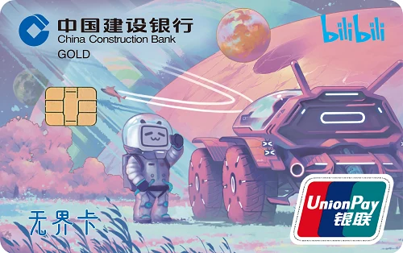
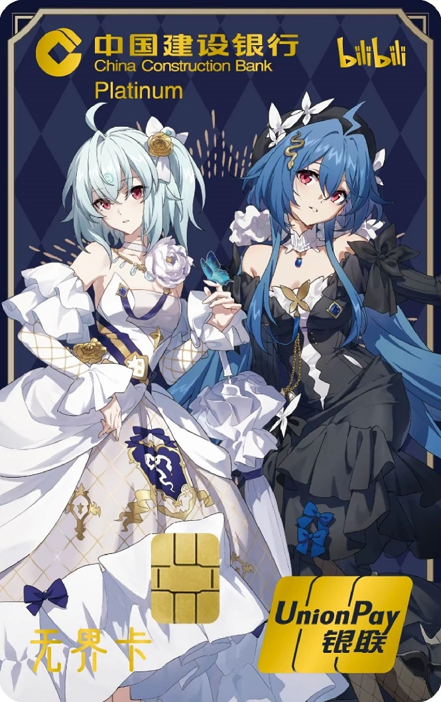

# 建行 龙卡 bilibili 信用卡（学生版）

来源：建行官网信用卡申请页（`cardId=20201113_1605255045` 三体动画学生版、
`cardId=20250120_1737363317` 2233星月版）、建行移动门户产品列表、建行「办卡须知」原文、
百度百科、第三方 DP（idawnlight，维护至 2025-09）。整理时间 2026-10。

## 🔴 先认卡等级：**学生版是「金卡」，标准版是「白金卡」**

这张卡的两个版本**卡面图案可以是同一套，但左上角那行等级英文不一样** ——
认卡别看中文名，**看左上角写的是 GOLD 还是 Platinum**：

| 版本 | 卡等级 | 面向 | 年费 |
| --- | --- | --- | --- |
| **学生版** | **金卡 Gold** | 学生 | **有效期内免年费** |
| **标准版** | **标准白金卡 Platinum** | 在职 | 主卡 580 元/年（交易满 10 笔免当年） |

> 建行官网两个申请页各自写得很明确：
> 学生版页 → 「卡等级：**金卡**」；2233星月版页 → 「卡等级：**标准白金卡**」。

### 学生版（金卡 / Gold）卡面

*图片来源：建行官网信用卡申请页（`cardId=20201113_1605255045`，该页明写
「卡组织：银联 / **卡等级：金卡** / 年费标准：有效期内免年费」）。
🔴 该页标着「**该产品暂不支持线上申请**」—— 这指的是**网页端不办学生版**，
学生版要走**建行手机银行 → 学生专区**（见下文「申请渠道的坑」），**不是产品停发**。
卡面为**三体动画版**：建行 2025-01-26 公告该**卡面**自 2025-01-27 起不再发行（见下节）。*

### 标准版（标准白金卡 / Platinum）卡面 —— ⚠️ **这不是学生版**

{ width="380" }

*图片来源：建行官网移动门户产品页（`cardId=20250120_1737363317`）。
该申请页明写「卡组织：银联 / **卡等级：标准白金卡** / 年费标准：主卡 580 元/年/卡」——
所以这张**是标准版、不是学生版**（学生版是金卡）。
2233星月版是 **2025 年新卡面**，卡面图案是 22 娘 / 33 娘。*

## ⚠️ 关于「停发」：停的是**卡面**，不是学生版

这一段必须写清楚 —— **很容易读错**。建行 2025-01-26 公告原文
（`ccb.com/cn/creditcard/news/detail/20250126_1737852463.html`）：

> 由于我行与幻电科技（上海）有限公司关于龙卡bilibili信用卡**太空探索版**及
> 龙卡bilibili信用卡**三体动画版卡面**授权即将到期，上述龙卡bilibili信用卡**卡面**
> 将于 **2025 年 1 月 27 日起不再发行**。上述两款龙卡bilibili信用卡卡面自
> **2025 年 8 月 26 日**起如遇办理损坏/挂失换卡、到期换卡等换发新卡业务时，
> 将**换发对应等级的最新龙卡bilibili信用卡卡面**，最新卡面可通过中国建设银行
> 手机银行查询。

**三个要点，别读错**：

| 要点 | 说明 |
| --- | --- |
| ① 停的是**「卡面」** | 只是「太空探索版 / 三体动画版」这两个**设计**不再发行 |
| ② **学生版没停发** | 公告写「换发**对应等级**的最新卡面」——**金卡（学生版）与标准白金卡两个等级都还在** |
| ③ 最新**金卡**卡面**在手机银行** | 网页端查不到（见下文） |

🔴 **顺带纠正一个很容易犯的错**：建行 2023-01-09 的另一份公告停发的是
**「小电视版 / 锦绣山河版」卡面**（自 2023-01-16 起）；2025-01-26 这份停发的是
**「太空探索版 / 三体动画版」卡面**。**两次公告停的一律是「卡面」，从来不是产品。**

## 一句话定位

**建行与哔哩哔哩联名卡的学生版**，2020-11 推出。**唯一一张把提额写清楚、且给了两条可操作路径
（声明书 / VTM）的学生卡**。卡组织**仅银联可选**，**自行申请额度为 1 元**。

## 产品谱系

**龙卡 bilibili 信用卡**由中国建设银行与幻电科技（上海）有限公司（哔哩哔哩）
面向年轻客群联合发行，2020 年 11 月推出，包含两种类型：

| 类型 | 卡等级 | 说明 |
| --- | --- | --- |
| **标准版** | **标准白金卡 / Platinum** | 在职客群；年费主卡 580 元/年 |
| **学生版** | **金卡 / Gold** | 学生客群；**有效期内免年费** |

🔴 **认卡别看中文名，看等级**：**学生版 = 金卡（Gold），标准版 = 标准白金卡（Platinum）**。

**历来的卡面（含已停发的）** —— ⚠️ 注意停发的都是**卡面**，不是产品：

| 卡面 | 状态 | 说明 |
| --- | --- | --- |
| **小电视版** | 卡面 **2023-01-16** 停发 | 首发卡面，光栅工艺「小电视」 |
| **锦绣山河版** | 卡面 **2023-01-16** 停发 | 2022 新增，布纹印刷 |
| **太空探索版** | 卡面 **2025-01-27** 停发 | 换卡时换发对应等级最新卡面 |
| **三体动画版** | 卡面 **2025-01-27** 停发 | 本页那张 **GOLD 学生版**用的就是这个卡面 |
| **2233星月版** | **现行** | 22 娘 / 33 娘，2025 新卡面 |

**换卡时「金卡（学生版）」与「标准白金卡」各自换发对应等级的最新卡面** ——
按公告口径，2233星月版**两个等级应当都有**；
但**金卡版的图只在建行手机银行里能看到**，网页端（含申请页的「学生专区」）
我实测京/沪/粤三地**都只有标准白金卡那张**，所以本页**拿不到现行金卡卡面的官方图**。

> ⚠️ **建行学生卡产品不止 bilibili 一张**：还有 **JOY 学生版**、「**建行生活**」系列学生版等。
> 建行学生卡的产品列表在官网信用卡「卡片列表」里**不能直接筛出来** —— 要看
> **建行手机银行 → 「学生专区」**。

## 🔴 申请渠道的坑：网页版找不到

**建行的学生卡（含 bilibili 学生版）只在手机银行「学生专区」办，网页端找不到。**

实测佐证：

- bilibili 学生版的产品页（`cardId=20201113_1605255045`）写着
  「**该产品暂不支持线上申请，请选择其他产品**」
- 网页版申请页的「学生专区」（`sinfo2.ccb.com/cn/creditcard/apply/new_mobile/cards.html`）
  里，**北京 / 上海 / 广东三地都只有** JOY 学生版、建行生活学生版、龙卡欢享学生版、
  LINEFRIENDS 学生版和各校校友卡 —— **没有 bilibili 学生版这一条**

**→ 想申建行 bilibili 学生版，走「建行手机银行 → 学生专区」，别在网页上找。**

## 🔴 核心机制：先核发「封存额度」，再释放

建行「办卡须知」原文（这是理解建行学生卡的关键）：

> 根据监管要求，客户网上申请后，我行**先核发「封存额度」的学生信用卡**
> （我行营销员现场指导申请的除外）。客户**邀请第二还款来源人前往我行任意网点签署
> 《中国建设银行大学生信用卡第二还款来源声明书及额度调整申请表》**以后，
> 即可**释放信用卡额度**。

**也就是说**：网申下来的卡额度是**封存**的，要拿到可用额度，必须**带第二还款来源人去建行网点
签一份专门的声明书+额度调整申请表**。

**卡组织仅银联可选**，**自行申请额度为 1 元**（不是 0 —— 可能是系统不支持零额度卡）。
页面提及可以由第二还款来源人担保提额。

### 第二条路径：VTM 自助释放（不用排柜台）

**2024-04-07 DP**：可以在较新的**建设银行 VTM**（远程视频柜员机）上操作

> 「个人业务 - 信用卡 - 大学生业务 - **释放封存额度**」
>
> 插入**第二还款人身份证**，填写资料即可释放额度。

这是学生卡里少见的**不用排柜台**的提额路径，值得优先试。

## 权益（bilibili 学生版 · 活动口径）

以下为活动期间口径，**权益与名额会变，以建行手机银行报名页为准**：

- **新户季卡礼**：新客户办理后，通过建行手机银行**报名**，
  且通过 POS 刷卡 / 云闪付 / 手机闪付等渠道（**不含微信、支付宝**）
  **任意消费 6 笔** → 领取 **B 站大会员季卡**一份，**限前 45000 名**
- **消费满额礼**：使用该卡累计**非微信、非支付宝**消费（云闪付、POS 刷卡等）
  **满 20000 元** → 价值 **233 元**的 **B 站大会员年卡**一份
- **月月消费返现**：单笔最高 **16 元**返现
- 2233 星月版另有「新户线上办卡达标享 **128 元**好礼」、季度达标礼等

> 🔴 **两个关键点**：
> 1. 必须通过**建行手机银行**「**报名**」后才计入
> 2. 几乎所有返现/礼品都**排除微信、支付宝**渠道 —— 要用**云闪付 / POS 刷卡 / 手机闪付**

## 其他学生卡：JOY 学生版 / 建行生活学生版

- **卡组织仅银联可选**，**自行申请额度为 1 元**
- 权益**不固定**，例如 **QQ 音乐联名卡送绿钻**，主要集中于新户礼
- 部分卡产品也属于**银联无界卡系列**
- **2023-12-25 DP**：新发主推的「**建行生活**」系列学生版**有运通人民币可选**
  （这是建行学生卡里少见的非银联选项）

## 毕业后的处理（DP）

- **2024-03-15 DP**：毕业后提额需要**线下进件**。建行工作人员口径：
  「**可以直接申请新卡片，核发带额度的在职卡；旧卡（学生卡）额度不变，不会自动调平，
  可自行销户**」
- **→ 所以毕业后是「申新卡 + 销旧卡」，而不是「旧卡提额」**

## 小结

- ✅ **提额路径写得最清楚**（声明书 + **VTM 自助释放**），且**额度是 1 元而非 0**
- ✅ bilibili 联名权益对学生友好（大会员季卡/年卡、返现）
- ✅ 有**运通人民币版**（建行生活系列）可避开纯银联限制
- ⚠️ **申请入口只在手机银行「学生专区」**，网页版找不到
- ⚠️ 领礼品必须**先报名**，且**排除微信/支付宝**渠道
- ⚠️ 卡组织**默认仅银联**（除建行生活系列）
- ⚠️ 毕业后走「**申在职卡 + 销学生卡**」路线，别指望旧卡自动提额

## 相关页面

- [学生信用卡总览](student-cards-overview.md)
- [工行 宇宙星座信用卡校园版](icbc-constellation-campus.md)
- [其他银行学生卡与停发清单](other-student-cards.md)
