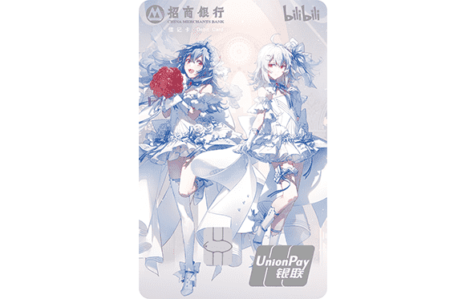

# 招商银行 bilibili 联名卡（储蓄卡 + 信用卡）

来源：招商银行官网「申请储蓄卡」产品页与联名卡宣传页、掌上生活活动页、
第三方 DP。整理时间 2026-10。

## 一句话定位

招行的 bilibili 联名**分两条线**：一张是**借记卡（储蓄卡）**，
一张是**信用卡**。名字里都带 bilibili，但**产品性质、申请门槛、办理渠道完全不同**，别搞混。

*图片来源：招商银行官网「申请储蓄卡」产品页（版权归招商银行所有，此处仅作识别用途）*

## 一、储蓄卡：哔哩哔哩花嫁联名储蓄普卡（借记卡）

### 是什么

**招商银行「哔哩哔哩花嫁联名储蓄普卡」** —— 在产品列表里与「招财主题储蓄普卡」、
「万事达人民币 IC 借记卡（普卡）」、「Hello Kitty 联名卡」等**并列**，
属于**普通一卡通借记卡换了个联名卡面**。

宣传语：**「纯白之爱无处不在」**。

### 卡面（已核验）

- 竖版圆角
- 主视觉是 **B 站 22 娘 / 33 娘**，白色花嫁（婚纱）风格裙装
- 背景浅蓝、白、淡紫，圆形光晕、花瓣、羽毛、星光效果
- 左上：招商银行标志 + 「招商银行 CHINA MERCHANTS BANK」+「借记卡」
- 右上：**bilibili 官方标志**（小电视 + bilibili 字样）
- **卡组织：银联（UnionPay）** —— 注意**不是万事达**

### 开户要点

- **本质是一卡通借记卡**：走的是普通借记卡的开户流程，**同样受一人一行多卡限制**
- 申请入口：**招商银行官网/App 的「申请储蓄卡」产品页**
  （`mobile.cmbchina.com` 的申请储蓄卡门户）
- 借记卡**不受学生信用卡那套监管约束**，
  **也不占「学生信用卡发卡银行 ≤ 2 家」的名额**

### 招商银行一卡通条款里值得注意的几条

1. **IC 卡有效期 5~10 年**（磁条卡无固定有效期），到期需换卡
2. 🔴 **联名方合作终止后，不再享受联名优惠，但借记卡功能持续有效**；
   **后续换卡不能再选原联名卡面**
   → 也就是说**联名卡面是「过期不补」的**，喜欢卡面就别轻易换卡
3. 🔴 **两年（含）以上不活动且余额为零**的账户，
   银行可将其**临时销户**（想长期保留就保持一点余额或偶尔用一下）

## 二、信用卡：bilibili 干杯联名信用卡

### 是什么

招商银行信用卡的 bilibili 联名产品线，**2024 年 8 月推出「干杯」主题**，
2026 年仍在持续做活动。更早还有一版 **bilibili 联名信用卡**
（招行信用卡站的 bilibili 专区）。

### 新户礼活动（2026-01-01 → 2026-03-31 期间申请的客户）

**达标条件（两条都要满足）：**

1. 在上述期间**成功申请并核发**该卡
2. 核卡后的**次两个自然月内**，使用该卡通过
   **支付宝快捷支付 / 微信快捷支付 / 云闪付 App 扫码**完成 **3 笔满 18 元** 的**经银联清算**交易

**礼品（13 选 1）**，在**掌上生活 App** 领取：

- **哔哩哔哩大会员年卡 + 干杯收藏集 12 抽**（最贴合 B 站用户）
- 康佳空气炸锅 / 兰蔻口红 / Midea 煎炒锅
- 原始人露营推车 / 游楽可拉杆箱 / NICI 云旅 20 寸拉杆箱
- ELLE 通勤运动双肩包 / ELLE 菱格单肩包
- Germ 铃兰保温杯 / 睡眠博士记忆枕
- 1000 积分 / 新户首年笔笔返现

**领取路径**：掌上生活 App → 我的 → 卡片权益 → 新户首刷礼。
⚠️ 本活动与招行**其他新户礼活动不同享**。

> 活动期与礼品会滚动更新 —— 上面的期次**已经过期**，
> 申请前请看掌上生活 App 或招行信用卡官网的**当期**新户礼。

## 怎么选：储蓄卡 还是 信用卡

| | 哔哩哔哩花嫁联名**储蓄**卡 | bilibili **干杯联名信用卡** |
| --- | --- | --- |
| 性质 | 借记卡，**先存后花** | 信用卡，**先花后还** |
| 门槛 | 低（凭身份证办借记卡） | 需信用审核（学生受监管限制） |
| 卡组织 | **银联** | 银联 |
| 拿卡面 | 卡面好看是主要理由 | 顺带有新户礼 |
| 网上申请 | 官网/App「申请储蓄卡」 | 招行信用卡官网/掌上生活 |
| 是否占学生卡名额 | **不占** | **占** |

**结论**：如果你只是**想要 B 站卡面 + 一张能用的借记卡** → 选**花嫁储蓄卡**，
不受学生信用卡监管限制、不占名额。
如果你**要的是新户礼和信用额度** → 走**干杯信用卡**，但要过信用审核。

## 相关页面

- [中国大陆银行卡总览](index.md)
- [招商银行 万事达卡（借记卡 + 信用卡）](cmb-mastercard.md)
- [招商银行 Young 卡 / 校园版（学生信用卡）](cmb-young-campus.md)
- [中国银行 bilibili 2233 联名借记卡](boc-bilibili-2233.md)
