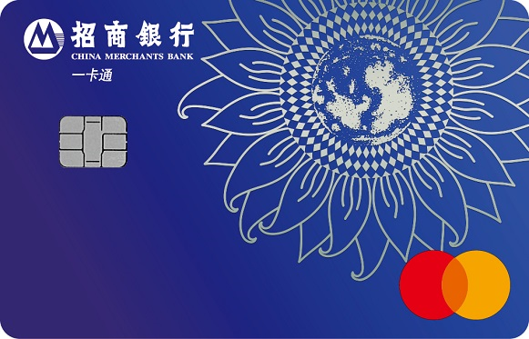

# 招商银行 万事达卡（万事达人民币 IC 借记卡 + 万事达信用卡）

来源：招商银行官网「申请储蓄卡」产品页、招商银行信用卡中心升级公告、
飞客（flyert）实测总结、万事网联公开信息。整理时间 2026-10。

## 一句话定位

招行的万事达产品线**分借记卡和信用卡两边**。
其中**「万事达人民币 IC 借记卡」的普卡是目前门槛最低的境内外通用借记卡之一**
—— **零门槛、无条件申请**，但 🔴 **必须去网点办，暂不支持网申**。

*图片来源：招商银行官网「申请储蓄卡」产品页（版权归招商银行所有，此处仅作识别用途）*

## 背景：万事达为什么现在能在境内用

**2024-05-09 万事网联信息技术（北京）有限公司正式开业**，
成为继中国银联、连通（美国运通）之后的**第三家银行卡清算机构**。

这意味着**万事达品牌的卡可以在境内清算**了 ——
在此之前万事达只能做外币/境外，境内靠银联。所以现在才出现
**「境内外都以人民币清算」的万事达借记卡**。

---

# 一、借记卡：万事达人民币 IC 借记卡

## 产品定位

**万事达卡与国内商业银行合作发行的首张境内外均以人民币清算的借记卡。**

宣传语：**「全球一卡通，一卡通全球」**。

## 两个版本

| 版本 | 卡 BIN（前 6 位） | 上线时间 | 账户类型限制 |
| --- | --- | --- | --- |
| **金葵花版** | `531063` | 2024 年 5 月 | 🔴 **强制占用一类账户**，不支持办二类卡 |
| **普卡** | `534293` | 2025-08-15 之后 | ✅ 支持新办**一、二类**，也支持以银联卡换卡 |

## 🔴 申请方式：网点柜面，不支持网申

- **普卡：零门槛、无条件申请**
- 🔴 **但需持本人身份证及手机「去网点申请」，暂不支持网申**
  （官网产品页有展示，但线上不能提交申请）
- 网点支持：**新办一类/二类卡**，以及**用已有银联卡换卡**
- **金葵花版**：仅支持**一类卡新办**或**银联卡换卡**

### 换卡工本费

- 换卡工本费 **5 元**
- 🔴 **名下已有金葵花借记卡或金卡借记卡可免**（普卡客户也可以和网点商量减免）

### 大部分网点没有预制卡 → 走 VTM

**普卡在大部分网点没有预制卡**，需要通过 **VTM（视频柜员机）**办理换卡：

1. 在 VTM 搜索 **`WSD`**（万事达人民币 IC 借记卡的简码）
2. VTM 提供 **5 次选号机会**
3. 办完后选择**网点取卡**或**邮寄**

> 💡 这个「VTM 搜 WSD」是个实操细节 ——
> 不知道的话柜面可能会告诉你「这卡没有预制卡」，然后就办不了了。

## 核心优势：境外消费不用购汇

| 优势 | 说明 |
| --- | --- |
| 🔴 **直接扣人民币** | 境外消费直接扣**人民币账户**，**不用提前购汇** |
| 🔴 **不占购汇额度** | **不占用个人年度购汇便利化额度**（这是它最大的意义） |
| 免货币转换费 | 免境外交易货币转换费 |
| 免境外取现费 | 免**每月前 3 笔**境外 ATM 取款手续费（**普卡免 1 笔**） |
| 免查询费 | 免境外 ATM 查询手续费 |
| 汇率补贴 | 境外消费**笔笔 5‰ 汇率补贴**（第三方口径） |
| 留学快汇 | 「留学快汇」学费购汇**点差 6.8 折**（第三方口径，优惠到 2025 年底，**次年是否延续未定**） |

## ⚠️ 使用限制（重要）

- **实体卡**：仅支持在**万事达商户**的 POS 上使用
- **ATM 取现**：目前仅支持**招商、建设、浦发、广发**四家银行的 ATM
- 🔴 **线上暂不支持云闪付**
- **免密交易限额 1,000 元**；**拍卡（非接触）交易限额 800 美元等值**
- **卡组织等级**：金葵花版与普卡**均为白金等级**

## 其他

- **积分与招行信用卡积分合并**（不是独立借记卡积分体系）
- 发卡后**外币流出入**走万事达清算网络

---

# 二、信用卡：万事达标准信用卡芯片版

- **支持境内境外使用**，**可绑支付宝、微信**
- 外币消费**以人民币入账**，**免外汇兑换手续费**
- **首年免年费，消费 6 笔免次年**

## 🔴 万事达全币种卡升级公告（2025-03-25 发布）

针对**卡号前 6 位为 `523649`** 的**万事达全币种卡**持卡人：

**1. 开通境内交易功能**

自 **2025-06-02** 起，该卡**可开通境内交易功能**：

- 支持绑定**境内第三方快捷支付**（支付宝、微信等）
- 线下可在**贴有「万事达卡」中文受理标识**的商户进行人民币交易
- 原有境外交易功能及权益**保持不变**

**2. 卡片升级核发**

自 **2025-06-02** 起，上述卡片**到期续卡、挂失补卡、毁损补卡、退货补寄**时，
将**升级核发为「万事达标准信用卡芯片版」**，原有卡号不变。新卡年费政策：

- **首年免年费，年消费满 6 次免次年**
- 主卡 **300 元/年**，附属卡 **150 元/年**

> 这解释了为什么现在搜「招行万事达信用卡」会看到两种名字 ——
> **全币种卡在换卡时统一并到标准卡芯片版**。

## 相关页面

- [中国大陆银行卡总览](index.md)
- [中国银行 bilibili 2233 联名借记卡（万事达 223300）](boc-bilibili-2233.md)
- [中信银行 美国运通人民币借记卡](citic-amex-debit.md)
- [招商银行 bilibili 联名卡](cmb-bilibili-card.md)
