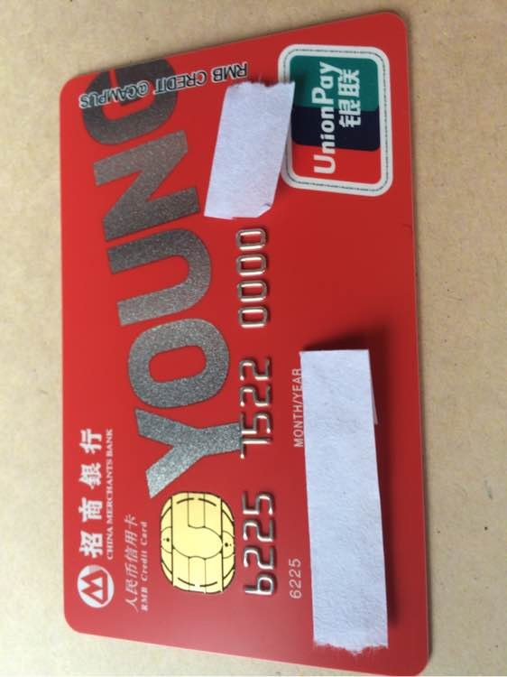
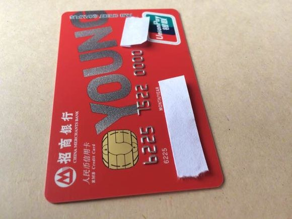
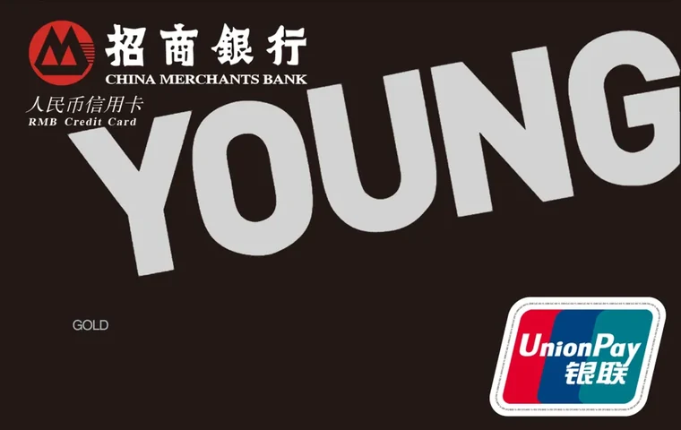

# 招商银行 Young 卡 / 校园版信用卡

来源：招行信用卡官网校园版 FAQ 帖、第三方卡片资料与长期维护的学生卡整理。
整理时间 2026-10。

> ⚠️ **本篇的"状态"一栏最需要留意**：招行校园版的发卡状态近年有反复，见下文「状态存疑」一节。
> 官网目前的校园版说明帖是**较早年份**的内容，权益与流程可能有变。

{ width="280" }
{ width="280" }

*校园版卡面为**红色**（上图为招行信用卡社区持卡人实拍，来源：[招行信用卡官网社区帖](https://xyk.cmbchina.com/LatteSubsite/jht/detail_75167.html)）*

**青年版（金卡 · 黑色）卡面**，与校园版不是同一张卡，放一起对比：

{ width="380" }

*卡面来源：[CardFaceDB](https://cardfacedb.com/card/492)（招商银行 · 银联 · 信用卡 · 金卡）*

## 两条产品线别搞混

| | **Young 卡（青年版）** | **校园版信用卡** |
| --- | --- | --- |
| 面向 | **非学生**客户 | **在校学生** |
| 年龄 | 主卡限 **30 周岁（含）以下**；30 周岁以上申请会被转为**银联标准信用卡** | 按学生身份 |
| 额度 | 有额度（视资质，每 6 个月可申请提额） | **毕业前额度封存** |
| 卡组织 | 银联单币（白/黑两套卡面） | 银联（部分为双币，含英雄联盟校园版等） |

> 招行称 Young 卡是**国内首张专属学生的双币信用卡**；后来学生部分演化为独立"校园版"。

## 校园版核心特征

| 项 | 说明 |
| --- | --- |
| **年费** | **卡片有效期内无条件免年费** |
| **额度** | **毕业前信用额度暂时封存** —— 通过**先存款后消费**使用 |
| **积分** | 可正常累积积分、享招行信用卡通用权益 |
| **费用减免** | 享校园专属特惠（如每月前两笔取现免手续费、存钱无手续费等，具体以当时公示为准） |
| **毕业转卡** | 毕业后转卡可**获得更高额度** |
| **申卡材料** | 本人身份证 + 核身短信 |
| **面签** | **需要网点面签** |
| **电话核身** | 当时说明为「暂时不会」 |

**官方对"额度封存"的解释**：

> "在小主毕业前，信用额度将暂时封存哈。通过先存款后消费，小主也可以正常享受积分累积等
> 招行信用卡权益及费用减免等校园专属特惠哦。提前积累信用，你将比别人拥有更高的起点！"

**毕业后的两条路**（官方原文口径）：

1. **走转卡功能**（当时称"后续将在掌上生活 App 上线"）→ 直接转卡，能获得更高信用额度 —— 官方更推荐
2. **直接申请标准版信用卡** → 按正常新户标准审核；核发后与校园版卡**共用同一个额度**，
   但**校园版的特权（取现手续费、溢缴款领回手续费减免等）将不再享有**

## 校园版专属权益（历史版本，供参考）

- **新户礼**：刷 **3 笔**任意消费、每笔满 **188 元**，到掌上生活 App 领取
- **通用权益**：线下商户消费打折、九积分兑换代金券/半价权益、周三餐饮半价（掌上生活抢券）、
  积分兑换礼品等
- **英雄联盟校园版**特有玩法：申请时填写本人 QQ 号，并在 LOL 信用卡页面绑定身份证号后，
  **排位赛与匹配赛每胜场累计 5 个招行积分**，每月赠送上限 **500 分**，**积分永久有效**
  - 一个 QQ 号每次仅能绑定一个身份证（可多次修改）

## Young 卡（青年版）的费用与权益

| 项 | 说明 |
| --- | --- |
| 年费 | 普卡 **100 元/年**、金卡 **300 元/年**；**首年无条件减免，刷卡 6 次免次年年费**，以此类推 |
| 取现 | **每自然月第一笔取现免手续费**；第二笔起按交易金额 **1%、最低 10 元/笔**（境内外无本异地、无跨行区别） |
| 预借现金额度 | 100%（部分卡面为 50%） |
| 免息期 | 20 – 50 天 |
| 积分 | 永久有效；主卡人生日月使用该卡消费**双倍积分**，赠送奖励积分上限 **2000 分/户** |
| 提额 | 视用卡及还款情况，**每 6 个月**可享额度升级机会 |
| 分期 | 出账单后可申请账单分期，**免利息、仅收手续费** |

## ⚠️ 状态存疑：申请前必须先确认

第三方长期维护该话题的整理（idawnlight）记录了几个关键节点：

| 时间 | 记录 |
| --- | --- |
| 2022-07-29 | 招行开始测试「**朝朝宝**」与零额学生卡的**一键关联** |
| **2022-09-25** | 招行**移除了所有校园版信用卡相关页面**；智能客服（掌上生活）自动回复仍在，但提示"如需申请，可前往附近招行网点" |
| **2022-10-10** | 出现**前往招行网点申请校园版但被秒拒**的案例，**存在已暂停对学生客户新发卡的可能** |
| **2024-03-12** | 🔴 **招行网点恢复对校园版信用卡的营销，主动推荐办卡，但未恢复网申渠道** |
| **2024-04-25** | 线下网点**可能会提供一个特定链接用于自主线上申请**（形如 `res.cc.cmbimg.com/itafront/...`），申请通过后寄送卡片 |

**结论（截至该整理的 2025-09）**：

- 招行校园版**卡产品未停发**，但**网申渠道已移除**
- **2024 年起网点恢复了营销**，且**可能会给你一个网点专属链接**自己线上提交
- 链接**可能关联特定网点**，且 App 中**并未直接提供**相关申请入口
- **→ 正确做法：直接联系当地招行网点**（或打 95555），不要照搬旧攻略

### 🔴 额度口径的冲突

两个第三方来源对招行校园版能否提额的说法**不一致**：

| 来源 | 说法 |
| --- | --- |
| 学姿势（**2020 年数据，已过时**） | 核卡时额度为 0，**父母短信确认担保后**才会视情况评估提额；提至 [1,5]K；**至多 10 次申请提额机会** |
| idawnlight（**维护至 2025-09**） | 这张卡是**没有任何途径提额的零额度卡**，且没有银联外的卡组织可选 |

> **以较新的口径为准：默认零额度且无提额途径。** 若网点声称能提额，
> 让网点**书面确认**再办。

### 一个很实用的小功能：朝朝宝「一键关联」

**2022-07-29 起**，招行向部分学生卡客户推送**朝朝宝的「一键关联」** ——
即当**预存金额不足时，可从朝朝宝账户自动赎回**。

对一个**必须先充值才能消费**的零额度卡来说，这**大幅提高了可用性**：
你不用手动算余额、提前转账，消费时自动从零钱理财里扣。

## 其他注意

- 招行校园版官方 FAQ 帖提到的活动与权益多数是**较早年份**的（正文可见 2015 年字样），
  **不能当作 2026 年现状**。上表权益仅供理解产品逻辑。
- 招行**学生卡不支持加办外币卡**（因政策调整）。
- 别忘了**监管的"两家银行"上限**：如果招行校园版已经办不了，就别把名额耗在不确定的产品上。
- 招行学生卡被第三方形容为「活动近几年出名的抠门」，仅有一个满 18 随机返现 ——
  **权益不是它的卖点，零额度卡本身也没什么申请价值**。
  详见 [学生信用卡总览](student-cards-overview.md) 第七节的替代方案。
