# 工行 宇宙星座信用卡校园版

来源：工行官网星座卡校园版产品页（**页面标注 2026 年 1 月版**）、工行微信公告号申请路径、
工行客服「学生卡信用卡办卡额度审批规定」页、第三方 DP（idawnlight，维护至 2025-09）。
整理时间 2026-10。

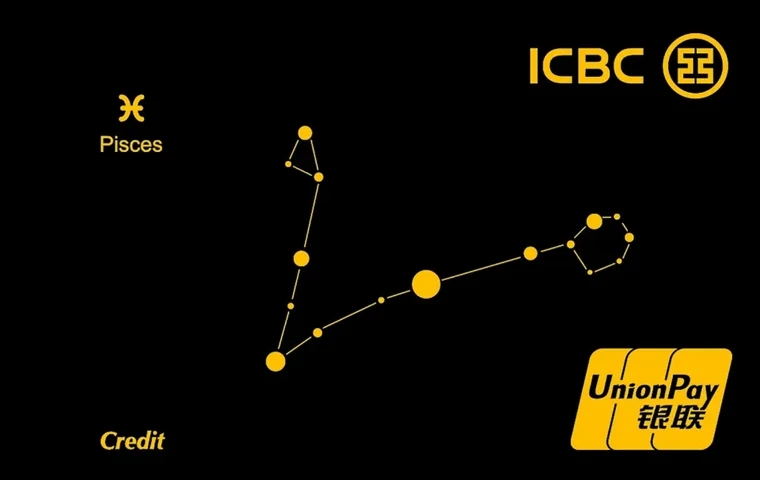

*卡面来源：[CardFaceDB](https://cardfacedb.com/card/540)（宇宙星座卡校园版 · 双鱼座）*

**12 星座卡面**（校园版沿用同一套星座卡面，申请时自选星座）：

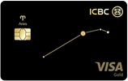{ width="148" }
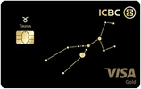{ width="148" }
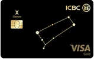{ width="148" }
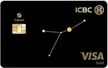{ width="148" }

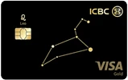{ width="148" }
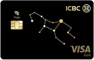{ width="148" }
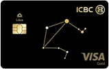{ width="148" }
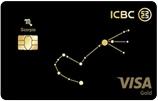{ width="148" }

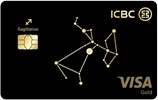{ width="148" }
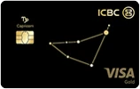{ width="148" }
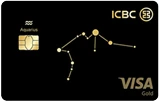{ width="148" }
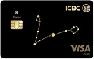{ width="148" }

*12 星座卡面来源：工行官网产品页（版权归中国工商银行所有，此处仅作识别用途）。图中为 VISA 金卡面，套卡另一张为银联单币卡。*

> 这是目前**官网资料最完整、且明确标注为大学生产品**的一张卡。
> 官网页面标注「2026 年 1 月版」，是本文所有产品里**时效性最好**的一份官方信息。

## 一句话定位

**门槛最低的学生卡（学姿势时期核卡率 82.28%，被称为「最佳备胎」）**，
**1+1 套卡**（境内银联 + 境外 VISA），**有效期内免年费**，**10 种外币 0 外汇兑换手续费**。
默认 **0 额度**。

## 产品结构：「1+1」办卡

同时核发**两张卡**：

| | 卡组织 | 用途 | 介质 |
| --- | --- | --- | --- |
| 境内卡 | **银联**单标识**单币**卡 | 境内消费 | 磁条 + PBOC 非接芯片 |
| 境外卡 | **VISA**单标识**多币种**卡 | 境外消费 | 磁条 + EMV 非接芯片 |

两卡**账户关联**，支持刷、插、挥、扫全支付模式。
产品等级为**普卡**，12 款星座卡面（白羊、金牛、双子、巨蟹、狮子、处女、天秤、天蝎、
射手、摩羯、水瓶、双鱼），12 星座烫印 + 蓝色侧边设计。
曾获 2018 年「卡界奥斯卡」ICMA 依兰奖「最佳支付卡」。

> ⚠️ **不支持以附属卡形式办理**，也不支持在本卡下办理其他信用卡的附属卡，
> 不支持办理副卡（手机附属卡除外）。

## 权益（官网原文口径）

| 权益类型 | 内容 |
| --- | --- |
| **年费** | 凡成功申办星座卡校园版，**即减免有效期内年费** |
| **容时** | 还款宽限期 **3 天**，到期还款日后 3 天内还款视同按时还款 |
| **容差** | 最低还款宽限差额 **100 元**；上期账单最低还款额未还部分 ≤100 元时视同全额还清计息 |
| **多币种免外汇兑换手续费** | 境外任意消费 **0 外汇兑换手续费** |
| **一元购生活小确幸** | 每月一元购买生活好礼 / 视频会员 / 运动健康 / 旅行优惠电子券 |
| **58 元健身 / 滑冰套餐** | 优惠价预订全国超 300 家连锁机构健身房服务 / 部分城市室内滑冰 |
| **爱购新客礼** | 工银信用卡新客户任意消费 1 笔，有机会领拉杆箱 / **108 元立减金** / 露营装备 / 潮玩玩具 |

**支持的 10 种外币**：美元、欧元、港币、英镑、日元、新加坡元、加拿大元、澳大利亚元、
瑞士法郎、新西兰元。在这 10 种货币对应国家/地区走 VISA 网络时**直接以相应币种入账**，
无需货币转换；10 种以外的国家/地区**自动免除**外汇兑换手续费。

## 🔴 额度与提额

**默认 0 额度。** 官网页面提及可以由第二还款来源人担保提额。官网另有明确一句：

> **有透支额度信用卡请至工行指定网点填写纸质申请表办理，
> 并提供《学生客户办卡还款承诺书》**（官网可下载）。

工行客服「学生卡信用卡办卡额度审批规定」页口径：
**牡丹学生信用卡根据学历不同，初始额度不同。以质押形式办卡，初始额度不受上述要求限制。**

### 三条提额路径与实测坑

**路径一：家属担保（承诺书）**

- 2023-07-11 DP：有案例在递交《学生客户办卡还款承诺书》和相关担保信息后**仍被拒绝提额**。
  卡部仍接受材料提交，但**不保证授信**
- 学姿势时期（已过时）的口径：家长担保后额度提至 [3, 3.5]K，且**成长性为「无」** ——
  即交了担保函也只有 3k，额度不会再变

**路径二：高校保险担保（免家属担保，最值得问）**

- 2023-07-12 DP：工行针对**部分高校**学生提供**保险**作为第二还款源，
  **无需家属担保**，直接授信额度 —— **本科 3k / 硕士 5k / 博士 8k**，
  需前往**高校对应的工行网点扫码办理**
- 建议：**致电工行信用卡客服咨询是否为所在高校提供授信额度**
- 2024-03-15 DP：客服只能查到**白名单院校列表**（不在名单内无法通过审批）和
  **试点院校列表**（名单内高校有支行称并无审批额度），
  **无法查询学校是否在「给授信额度」的学校之列** → 建议直接联系**离学校最近的工行网点**
- 2024-03-15 DP：**在线客服**查询是否对某院校提供授信额度，可能比电话客服更有效

**路径三：质押办卡** —— 客服口径称以质押形式办卡初始额度不受学历限制。

## 申请方法（有坑，照这个走）

**推荐路径**：**工行微信公众号** → 「信用卡申请」→ 任选一个**非学生卡**的卡种
→ 按流程申请 → **填写工作时选择「学生」** → 即会弹出学生可以申请的卡片列表。

> 🔴 **坑**：**手机银行 / 工银 e 生活 App 可能无法进入新版申请页面，
> 会直接提交申请然后拒绝。** 别在 App 里试。

**其他学生可申卡种**（同一路径下可看到）：奋斗套卡、环球影城金、留学金套卡等。

另一条官方路径：关注「中国工商银行信用卡」官方微信公众号，回复「星座卡」在线申请。

## 🔴 征信报送：会多出 10 个外币账户

这是本卡**最有必要事先知道**的一点（官网特别说明）：

> 根据人民银行征信系统数据采集规范，**多币种信用卡按账户进行报送和展示**，
> 即征信报告中会**分别展示人民币及 10 个外币账户信息**，
> 每条账户记录对应的卡片尾号均展示为**同一主卡尾号**。

- **不影响**你的信用记录
- 其中某个币种账户逾期，**不影响**其他币种账户的正常展示
- 但客观上，你的征信报告上会**多出 10 条账户记录** —— 如果你在意征信报告的条数观感，
  申请前请先想清楚

## 零额度下的使用体验（DP）

- 此前**存入人民币无法直接外币消费**，可能需要**购汇转入**
  → 零额度情况下，相较中行跨境通借记卡等**没有明显优势**
- 可用支付宝 / 微信的「信用卡还款」功能给两张卡充值，**它们共享同一个人民币额度**
- 卡内有人民币额度后即可正常境内消费（可薅云闪付的券等）
- **只有人民币额度时 VISA 功能受限**；需有外汇可用额度后，VISA 功能才全解锁
  （可绑微信、支付宝、PayPal、Samsung Pay、Apple Pay、Google Wallet）

## 小结

- ✅ **有效期免年费**、**10 种外币 0 外汇兑换手续费**、门槛低、卡面好看
- ✅ 若高校在**保险担保白名单**内 → 免家属担保直接拿 3k/5k/8k，是学生卡里少见的实惠
- ⚠️ 默认 **0 额度**，家属担保提额**不保证成功**
- ⚠️ 征信报告会多 **10 条外币账户**记录
- ⚠️ 申请务必走**微信公众号**路径，App 会直接拒
- ⚠️ 零额度 + 需购汇才能外币消费 → 若只为外币消费，不如办**借记卡**（见
  [学生信用卡总览](student-cards-overview.md) 第七节）

## 相关页面

- [学生信用卡总览](student-cards-overview.md)
- [建行 龙卡 bilibili 信用卡学生版](ccb-bilibili-campus.md)
- [其他银行学生卡与停发清单](other-student-cards.md)
