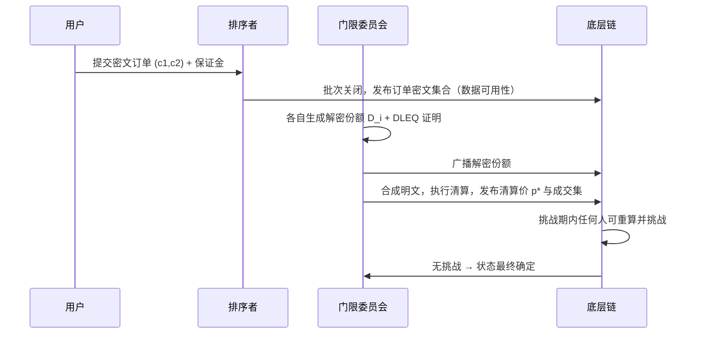

# BATCH：密封竞价批处理清算层

**技术设计草案 · v0.1 · 2026-10**

!!! warning "文档性质"

    本文是**协议技术设计文档**，讨论的是交易撮合与密码学机制的工程可行性，不构成任何代币发行、募集资金、投资邀约或收益承诺。

    文中"代币"一节讨论的是机制设计中的激励与罚没问题，第 9.4 节专门论证了**什么情况下根本不需要代币**。中国大陆境内虚拟货币发行与交易属被禁止的金融活动，本文不面向境内提供任何相关服务。

## 摘要

公开内存池把用户的交易意图在成交前暴露给所有人，由此产生了结构性 MEV（最大可提取价值）：抢跑、三明治、清算狙击。现有的缓解手段——私有交易通道、提议者-构建者分离（PBS）——只是把提取权重新分配给了少数参与者，没有消除泄漏本身。

BATCH 的思路是**从根上不产生可用的排序信息**：

1. 订单在提交时用门限加密封存，任何单一实体都无法提前解密；
2. 批次关闭后由门限委员会协同解密；
3. 同一批次内所有成交按**统一清算价**结算。

第 3 点是关键——在统一价机制下，批次内的排序**不产生任何经济价值**，因此"买通排序权"这门生意在协议层就失去了标的。

---

## 1. 问题定义

设某交易对在时刻 `t` 的订单集合为 `O`。在传统 AMM 或连续竞价撮合中，成交结果依赖于订单的**到达顺序**：先到的单以更优价格成交。于是：

- 观察到一笔大额买单 → 在其之前插入买单 → 推高价格 → 卖出获利（三明治）；
- 观察到清算交易 → 抢先执行清算（清算狙击）；
- 排序权本身成为可拍卖的商品（PBS 下的区块空间拍卖）。

**关键观察：泄漏的不是订单内容本身，而是"订单与排序的相对位置"所蕴含的确定性收益。**

由此得出一条设计判据：

> 如果成交结果与批次内顺序无关，那么排序权就没有价值，也就没有为排序权付费的市场。

## 2. 设计目标与非目标

### 2.1 目标

| 目标 | 判据 |
|---|---|
| 消除批次内排序 MEV | 任意两笔同批订单交换位置，清算结果不变 |
| 提交前不可见 | 除持有 `t` 份密钥份额者外，无人能解出订单内容 |
| 可验证清算 | 任何人可重算清算结果并挑战错误 |
| 抗审查 | 用户可通过底层强制纳入通道绕过不合作的排序者 |
| 不依赖外部价格预言机 | 价格完全由本批内部供需导出 |

### 2.2 非目标（明确不做）

- **不做跨场所 MEV 的消除**。协议只约束自己批次内的排序；委员会若提前获知清算价，仍可在其他场所抢先交易。这一点在 8.1 单独讨论，不能含糊过去。
- **不做价格发现的最优化**。统一价是刻意选择的机制，代价见第 10 节。
- **不追求毫秒级延迟**。密封竞价的固有成本是"必须等一批"，见 10.3。

## 3. 协议总览



时间轴（一个 epoch）：

```
t=0        批次开始，接收加密订单
t=Δ        批次关闭，密文集合上链（Δ = 12s）
t=Δ+2s     解密份额收集完成（门限 t of n）
t=Δ+4s     清算结果与清算价发布
t=Δ+4s+W   挑战期 W（乐观模式 W=30min；有效性证明模式下 W=0）
```

## 4. 密码学构造

### 4.1 门限加密

采用门限 ElGamal（基于 secp256k1 或 BLS12-381 的 G1）：

```
系统公钥   Y = g^y
私钥分片   y_i 为 y 的 Shamir 份额，门限 (t, n)
加密       (c1, c2) = (g^r, m · Y^r)        r 随机
解密份额   D_i = c1^{y_i}
份额校验   DLEQ 证明：log_g(Y_i) == log_{c1}(D_i)
合成       m = c2 / Π_{i∈S} D_i^{λ_i}      |S| = t，λ 为拉格朗日系数
```

**DLEQ 证明不可省略。** 没有它，恶意委员会成员可以提交错误的 `D_i` 使合成结果变成任意值，而外部无法区分是"出错"还是"作恶"。有了它，错误份额可被任何人定位并触发罚没。

### 4.2 订单编码（容易翻车的地方）

ElGamal 的明文必须是群元素，而订单是 `(方向, 价格 tick, 数量 lot)` 这样的整数元组。直接把 64 位整数当作 `m` 是错的——落不到群上。工程上有两条路：

**方案 A：指数编码。** 令 `m = g^v`，`v` 为编码后的整数。解密得到 `g^v` 后需求离散对数。若约束 `v < 2^40`，用 BSGS（baby-step giant-step）可在约 `2^20` 步、几百 MB 内存内解出，单批几千笔订单在秒级可完成。
**代价**：订单参数被限定在 40 位空间内，价格 tick 与数量 lot 必须按交易对预设。

**方案 B：可搜索加密 + 分片明文。** 密文按位切分，逐位解密。带宽开销随位宽线性增长，不划算。

本文采用方案 A，并把 40 位拆成 `方向 1 bit | 价格 20 bit | 数量 19 bit`——足以覆盖单一交易对的合理撮合精度。

### 4.3 提交与保证金

订单提交需附小额保证金（可退还）。这不是为了收费，而是把"粉尘洪泛"的成本从委员会转嫁给攻击者（见 8.4）。

## 5. 清算算法

### 5.1 统一价双向拍卖

批次内收集到的买单按价格降序累计得到需求曲线 `D(p)`，卖单按价格升序累计得到供给曲线 `S(p)`：

```
p* = argmax_p  min(D(p), S(p))
Q* = min(D(p*), S(p*))
```

**所有成交订单，无论报价高低，一律按 `p*` 结算。**

- 报价高于 `p*` 的买单成交，成交价 `p*`（低于其心理价位，得利）；
- 报价低于 `p*` 的卖单成交，成交价 `p*`（高于其心理价位，得利）；
- 边界处的部分成交按比例分配。

### 5.2 为什么这一条能杀掉排序 MEV

在统一价下，同批内任意两笔成交单互换位置，成交价与成交量都不变——**排序不携带信息，也不携带价值**。攻击者即便买通排序者插入自己的订单，也只能获得与其他人相同的价格，无法通过"排在你前面"获利。

这不是把 MEV"重新分配"，而是让它在机制层失去标的。

### 5.3 并列清算价的处理

当 `argmax` 不唯一时，取满足条件的**最低** `p*`（对买方有利、抑制卖方操纵）。规则写死，不留解释空间——模糊规则本身就是可被利用的攻击面。

## 6. 结算与证明

两条可选路径，按阶段切换：

### 6.1 乐观模式（第一阶段）

清算结果连同解密后的完整订单集发布上链。挑战期 `W` 内，任何人可本地重算 `p*` 与成交集；不一致则提交欺诈证明，罚没排序者与出错的委员会成员。

- 优点：实现简单，计算开销低；
- 缺点：需要 `W` 的最终性延迟，且依赖至少一个诚实挑战者在线。

### 6.2 有效性证明模式（第三阶段）

把"排序 + 累计 + 求交点"编译成电路，生成有效性证明。主要难点是 `argmax` 这类比较选择在电路里代价高——通常做法是把清算阶梯离散化为固定档位（例如 4096 个价格档），把 `argmax` 转成"在 4096 个候选里找最大值"，电路规模可控但证明时间仍在秒级到十秒级。

**这里必须诚实**：zk 证明的成本在批处理场景下不是免费的，吞吐会被证明生成拖住。因此第二阶段仍以乐观模式承载主要流量。

## 7. 抗审查与逃生通道

排序者可以拒绝某笔订单。协议必须给出不依赖其善意的不合作出口：

1. 用户把订单哈希 + 保证金提交到底层链的 `forceInclude` 合约；
2. 若在 `k` 个 epoch 内该订单未出现在任何批次的密文集合中，判定审查成立；
3. 排序者被罚没，该订单进入"强制纳入"队列，下一个批次必须包含。

这一机制与 rollup 的强制纳入同构，是**唯一的**抗审查保证来源。没有它，任何"去中心化排序"的说法都不成立。

## 8. 攻击面分析

| 攻击 | 前提 | 后果 | 缓解 |
|---|---|---|---|
| 委员会 `t` 人合谋 | 控制门限份额 | 提前解密 → 跨场所抢跑 | 轮换、地理分散、限制单批名义规模上限 |
| 排序者审查 | 掌握出块权 | 特定用户被排除 | 底层强制纳入（第 7 节） |
| 粉尘洪泛 | 低成本提交 | 解密与清算被拖慢 | 保证金 + 单批订单上限 + 速率限制 |
| 跨批次抢跑 | 观察批间价差 | 在相邻批次套利 | 缩短 epoch、批次关闭加随机延迟 |
| 错误清算 | 排序者作恶或 bug | 用户被错误定价 | 欺诈证明 / 有效性证明 + 罚没 |
| 数据不可用 | 只发承诺不发密文 | 无法验证 | 密文集合必须完整上链（DA 前置条件） |

### 8.1 委员会合谋是真实存在的泄漏

必须写清楚：若 `t` 个成员合谋，他们能提前知道本批清算价，从而在其他交易场所抢先交易。**这是密封竞价无法消除的残余风险**，只能通过降低概率（大 `n`、频繁轮换、成员准入审查）和降低单批可提取价值（限制单批名义规模）来压缩。

任何声称"完全消除 MEV"的设计，都会在这里失守。

## 9. 代币机制

### 9.1 用途

| 用途 | 说明 |
|---|---|
| 罚没保证金 | 委员会成员与排序者按名义规模质押，作恶即罚没 |
| 费用计价 | 按成交名义额收取比例费 |
| 治理 | 参数变更投票（有界范围 + 时间锁） |

### 9.2 费用分配

```
50%  销毁
40%  委员会与排序者
10%  保险金库（覆盖清算错误的赔付）
```

固定总量 `1e9`，**不设增发**。

### 9.3 为什么不增发

增发会稀释持币者来支付安全预算，而安全预算的真实来源应当是**协议实际承载的交易量**。如果费用收入不足以支撑足够的质押规模，说明协议没有真实需求——此时用增发掩盖问题，只会把亏损转嫁给最后进场的人。

### 9.4 什么情况下根本不需要代币

这一节是本文档最应该被认真读的部分。

**如果目标仅是抗审查撮合，完全可以用 ETH 或 USDC 做保证金，不需要发行任何新资产。** 代币化只在同时满足以下条件时才说得通：

1. 协议需要**独立于底层资产的安全预算**（即底层资产波动会破坏罚没的实际约束力）；
2. 需要把治理权与**使用量**绑定，而非与持币量绑定；
3. 有可持续的费用流，能够在不增发的前提下支撑质押收益率。

**任何一条不满足，发币就是给融资找理由，而不是给协议补安全。** 本文不假设三条都已成立——v0.1 阶段的默认配置是"以 ETH 计价保证金、暂不发行代币"，代币路径作为 v1.0 的可选升级保留。

## 10. 已知局限

**10.1 只适用于链上有流动性的资产。** 没有对手盘的交易对，统一价拍卖无解——`Q*` 会长期为 0。

**10.2 统一价对大额单不利。** 大额买单无法通过提高报价优先成交，只能等批量匹配，价格发现能力弱于连续竞价。这是用效率换公平的直接代价。

**10.3 延迟是硬成本。** 必须"等一批"。12s epoch + 解密 + 结算，端到端体验落后于中心化交易所数个数量级。对高频策略基本不可用。

**10.4 门限委员会是信任假设。** 这不是无信任系统，是"信任分散在 `n` 个成员中且作恶会被罚没"的系统。把它说成去中心化是话术。

**10.5 跨链资产依赖桥。** 桥是历史攻击最密集的环节，这一风险无法由本协议消除。

**10.6 解密成本随订单数增长。** 单批订单数受 BSGS 求解与带宽双重约束，实测上限需要压测验证，v0.1 不给出承诺数字。

## 11. 与相关工作的差异

| 方案 | 泄漏点 | 与本设计的关系 |
|---|---|---|
| 私有交易通道（如 Flashbots Protect） | 依赖中继不作恶 | 只是把泄漏对象从公开变私有，仍需信任 |
| PBS / 区块空间拍卖 | 排序权被明码标价 | 重新分配 MEV，不消除 |
| 阈值加密内存池 | 解密后仍需排序 | 若排序有价值，泄漏只是被推迟 |
| 本设计 | 批次内排序无价值 | 用统一价**消解**排序价值，而非隐藏它 |

关键差异：多数方案解决"看不见"，本文解决"看见了也没用"。

## 12. 路线图

| 阶段 | 内容 | 明确不做的事 |
|---|---|---|
| v0.1 测试网 | 单交易对、乐观模式、强制纳入 | 不承诺主网上线时间 |
| v0.5 | 多交易对、委员会轮换、压测订单上限 | 不发代币 |
| v1.0 | 有效性证明替换欺诈证明、参数治理 | 不承诺收益率、不做流动性挖矿 |

**不写"预计 TVL"、不写"生态伙伴"、不写"将由社区决定"。** 这些是白皮书里最常见的空话，写上去只会降低文档的可信度。

## 13. 参考

1. Daian et al., *Flash Boys 2.0: Frontrunning in Decentralized Exchanges, Miner Extractable Value, and Consensus Instability*, IEEE S&P 2020.
2. Budish, Cramton, Shim, *The High-Frequency Trading Arms Race*, QJE 2015.（批处理拍卖的理论源头）
3. Shamir, *How to Share a Secret*, CACM 1979.
4. Buterin, *Proposer/Builder Separation* 相关讨论, 2021–2023.
5. 关于统一价拍卖的机制设计文献：Wilson, *Nonlinear Pricing*, 1993.

---

*文档版本 v0.1，尚未经过同行评审。第 9.4 节的结论是"现阶段不需要代币"，如果这一结论与读者预期不符，请以论证为准，而非以预期为准。*
