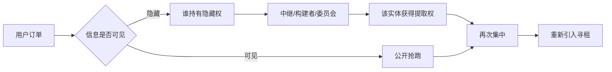
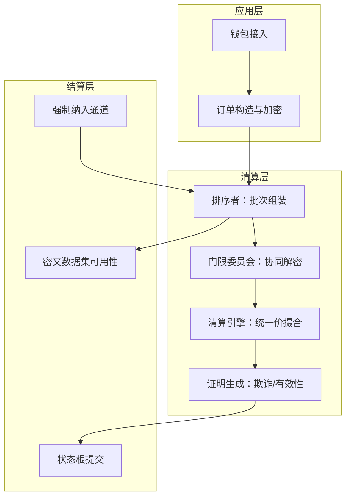

# BATCH：密封竞价批处理清算层

**Technical Whitepaper · v1.0 · 2026-10**

!!! warning "文档性质"

    本文是**协议技术设计与机制研究文档**，不构成任何代币发行、募集资金、投资邀约、证券发行或收益承诺。文中的代币参数是机制设计中的假设值，用于讨论激励相容性，**不是发售条款**。

    中国大陆境内虚拟货币发行、交易及相关业务活动属被禁止的金融活动，本文不面向境内提供任何产品、服务或投资渠道。

---

## 摘要

区块链的公开内存池在交易成交之前，就把用户的意图广播给了所有人。这不是实现缺陷，而是"先到先得"这一排序规则的必然产物：既然排序决定收益，排序权就一定会被定价、被拍卖、被垄断。

我们提出 BATCH——一个**让排序权失去价值**的清算层。

核心机制建立在一条容易被忽略的判据上：

> 如果成交结果与批次内的顺序无关，那么"买通排序"这件事就没有标的物。

BATCH 由此给出三件事：

1. **封**——订单提交时以门限 ElGamal 密文形式存在，任何单一实体（包括排序者、委员会成员、验证者）都无法在批次关闭前读出内容；
2. **集**——一个 epoch 内的订单被打包成一批，批次结束后由 `t-of-n` 门限委员会协同解密；
3. **一**——同批所有成交按**统一清算价**结算。

第三点是全部设计的关键。前两点解决"看不见"，第三点解决"看见了也没用"。业内大部分方案止步于前两点，于是 MEV 只是被推迟到解密之后，并未消失。

**主要贡献：**

- 提出以统一价拍卖消解排序价值的设计判据，并给出排序无关性的形式化陈述；
- 给出一套可在通用曲线上落地的订单编码方案（4.2 节），规避了 ElGamal 明文必须落在群上这一常见陷阱；
- 给出乐观证明与有效性证明两阶段并存的结算路径，明确 zk 在批处理场景下的真实成本；
- 建立门限委员会合谋的可量化泄漏上界（8.1 节），而不是宣称"完全消除 MEV"；
- 在代币设计之外，保留了一条**不发币**的可行路径（10.7 节）。

---

## 1. 引言

### 1.1 一个被定价的权力

2019 年，Daian 等人把"矿工可提取价值"（MEV）写进学术文献时，很多人以为这是一个可以靠工程手段修补的 bug。六年过去，这个数字的量级只增不减，而修补方案接连失效，原因值得追究。

每一次失败的方案，都遵循同一种思路：**遮蔽信息**。

- 私有交易通道：把你的交易藏进中继，不让公开内存池看见；
- 加密内存池：用门限加密把交易封住，等打包时再解；
- 提议者-构建者分离：把排序权集中到专业构建者手里，靠市场竞争约束其行为。

三者的共同点是：它们都假设"只要看不见，就不会被抢"。但它们都保留了一个前提——**排序仍然决定收益**。

只要这个前提在，信息就一定会以某种形式泄漏：中继会看到、解密会发生、构建者会知道。泄漏只是被推迟、被集中、被重新定价，从未被消除。

### 1.2 换一个问法

与其问"如何让别人看不见我的订单"，不如问：

> **凭什么排序能换钱？**

答案很简单：因为在连续竞价里，先到的单拿更好的价格。价格随顺序变化，顺序就有价值。

那么反过来——如果无论排第几都拿同一个价格呢？

排序立刻变得一文不值。攻击者即便买通了排序者，插队也只能拿到和别人一样的价格。**抢跑这项业务在协议层就失去了标的物。**

这就是 BATCH 的整个出发点。它不是一个"更隐蔽的内存池"，而是一个**重新定义了成交规则的清算层**。

### 1.3 这个设计代价是什么

诚实地说，代价不小，而且不可回避：

- 必须"等一批"，延迟是硬成本；
- 统一价牺牲了大额单的价格发现能力；
- 门限委员会是一个信任假设，不是无信任系统；
- 跨批次的泄漏依然存在。

第 12 节和第 16 节会把这些代价一条条列清楚。**一份不敢写代价的白皮书，不值得读第二遍。**

---

## 2. 背景

### 2.1 MEV 的演化

| 阶段 | 形态 | 提取者 |
|---|---|---|
| 2017–2019 | 抢跑、三明治 | 任何观察内存池的人 |
| 2020–2022 | Flashbots 私有通道、捆绑交易 | 搜索者 + 矿工 |
| 2023–2025 | PBS、区块空间拍卖、builder 市场 | 专业构建者 |
| 2026– | 订单流拍卖（OFA）、意图导向 | 订单流持有者 |

趋势很清晰：**提取权从分散走向集中，从公开走向私有，从套利走向收租。**

这不是技术进步，这是寻租效率的提升。

### 2.2 现有方案的结构性局限



无论走哪条分支，终点都是"某个实体拥有排序权，并将其变现"。**只要排序有价，这条流水线就会自己重建。**

### 2.3 批处理拍卖的理论根

Budish、Cramton 与 Shim 在 2015 年研究高频交易军备竞赛时提出：把连续市场改为**频繁批量拍卖**（frequent batch auction），可以消除速度优势带来的租金。

他们的结论是针对传统金融市场的。BATCH 的工作是把这一结论移植到链上，并补上两个链上特有的问题：

1. 谁来执行批处理？（→ 门限委员会 + 可验证清算）
2. 用户怎么相信批处理没被操纵？（→ 欺诈证明 / 有效性证明）

---

## 3. 设计哲学

**原则一：不隐藏信息，消除信息的价值。**
隐藏是脆弱的——总有人能看到。消除价值是结构性的——看到了也无利可图。

**原则二：可验证优先于可信任。**
委员会可以作恶，但作恶必须留下可被任何人检查的痕迹，并且这个检查不依赖委员会的配合。

**原则三：把代价写在明面上。**
延迟、中心化程度、资本效率损失，全部量化列出。用模糊措辞掩盖代价的设计，最终会在主网上用事故来补课。

---

## 4. 协议架构

### 4.1 分层



### 4.2 订单生命周期

```
构造  → 用户本地生成 (方向, 价格tick, 数量lot)
加密  → 用系统公钥 Y 加密为 (c1, c2)，附保证金
提交  → 发送给排序者（或直接广播）
封批  → 排序者收齐后，把密文集合提交 L1（数据可用性锚定）
解密  → 委员会成员各自产生份额 D_i + DLEQ 证明
合成  → 收集 t 份份额，恢复明文
清算  → 计算 p* 与成交集，发布结果
挑战  → 挑战期内任何人可重算；无异议则最终确定
```

### 4.3 时间轴

```
t = 0          批次开启
t = Δ          批次关闭，密文集合上链        (Δ = 12s)
t = Δ + 2s     解密份额收集完成              (t-of-n)
t = Δ + 4s     清算结果与清算价发布
t = Δ + 4s + W 挑战期结束，状态最终确定      (乐观模式 W = 30min；有效性证明模式 W = 0)
```

`Δ = 12s` 是一个工程折中：更短则解密与带宽吃紧，更长则用户体验崩坏。这个参数在治理范围内可调，但被约束在 `[6s, 60s]` 区间内——**允许优化，不允许取消等待**。

---

## 5. 密码学层

### 5.1 门限加密

采用门限 ElGamal，底层群取 secp256k1 或 BLS12-381 的 G1。

```
系统公钥    Y = g^y
私钥分片    y_i 为 y 的 Shamir 份额，门限 (t, n)
加密        (c1, c2) = (g^r, m · Y^r)          r 随机
解密份额    D_i = c1^{y_i}
份额校验    DLEQ 证明：log_g(Y_i) == log_{c1}(D_i)
合成        m = c2 / Π_{i∈S} D_i^{λ_i}        |S| = t，λ_i 为拉格朗日系数
```

**为什么 DLEQ 不能省。** 没有它，恶意成员可以提交任意的 `D_i`，使合成结果变成攻击者选定的值，而外部无法区分"实现 bug"与"蓄意作恶"。有了它，错误份额被任何人定位，罚没条件变得客观可判。

### 5.2 订单编码——最容易翻车的地方

ElGamal 的明文必须是群元素，而订单是 `(方向, 价格, 数量)` 这样的整数元组。直接把 64 位整数当 `m` 会落不到群上，这是无数实现踩过的坑。

**方案 A：指数编码。** 令 `m = g^v`，解密得到 `g^v` 后用 BSGS 求离散对数。

```
v 的位宽约束   40 bit
拆分为         方向 1 bit | 价格 20 bit | 数量 19 bit
BSGS 复杂度    O(2^20) 步，内存约数百 MB
单批求解       数千笔订单可在秒级完成
```

代价是订单参数被限制在 40 位空间内，价格 tick 与数量 lot 需按交易对预设。对单一交易对的撮合精度而言，20 位价格档（约 100 万档）是足够的。

**方案 B：逐位可搜索加密。** 带宽随位宽线性增长，在批处理场景下不划算，不采用。

### 5.3 密钥轮换

委员会每 `E` 个 epoch 换届一次（`E = 100`）。轮换采用可验证秘密分享（VSS）重新分发：新旧委员会之间做份额转移，不暴露主私钥。

轮换的另一个作用是把"长期潜伏的合谋"打断——即便某届委员会被渗透，影响窗口也被限制在 `E` 个 epoch 内。

### 5.4 保证金与质押

| 角色 | 职能 | 质押要求 | 罚没条件 |
|---|---|---|---|
| 委员会成员 | 协同解密 | 固定额度 | 错误份额、泄漏明文、离线率超标 |
| 排序者 | 批次组装 | 按单批名义额比例 | 审查、错误清算、数据不可用 |
| 挑战者 | 提交欺诈证明 | 挑战保证金 | 恶意挑战（重算不符） |

---

## 6. 清算引擎

### 6.1 统一价双向拍卖

```
需求曲线  D(p) = Σ 买单数量，其报价 ≥ p
供给曲线  S(p) = Σ 卖单数量，其报价 ≤ p
清算价    p* = argmax_p  min(D(p), S(p))
成交量    Q* = min(D(p*), S(p*))
```

所有成交订单，**无论报价高低，一律按 `p*` 结算**。

- 报价高于 `p*` 的买单全部成交，多付的部分自动得利；
- 报价低于 `p*` 的卖单全部成交，少收的部分自动得利；
- 边界处按比例部分成交。

### 6.2 一个具体例子

某批次买单：`@101: 30`, `@100: 50`, `@99: 80`；卖单：`@97: 40`, `@98: 60`, `@100: 70`。

```
p = 100  →  D = 80  (30+50)      S = 100 (40+60)      min = 80
p = 99   →  D = 160 (30+50+80)   S = 100              min = 100
p = 98   →  D = 160              S = 160              min = 160   ← 最大
p = 97   →  D = 160              S = 200              min = 160
```

清算价 `p* = 98`，成交量 `Q* = 160`。

注意：报价 101 和 100 的买单、报价 97 和 98 的卖单，**全部以 98 成交**。没有人因为"报得更高"而多赚，也没有人因为"排得更前"而先成交。

### 6.3 排序无关性（形式化陈述）

设批次的成交集合为 `O`，清算函数为 `Clear(·)`，`π` 为 `O` 上的任意置换。

**不变式 I1（排序无关）：**

```
Clear(O) = Clear(π(O))   对任意置换 π 成立
     在 (p*, Q*, 各订单成交量) 上相等
```

**推论：** 排序权在批次内不携带经济价值，因此不存在"为排序付费"的均衡。

**边界情形的诚实说明：** 当多个订单报价恰好等于 `p*` 且需要部分成交时，分配必须有一个确定性规则。BATCH 采用"按订单哈希字典序"分配，而非"按到达时间"。规则写死在协议里，不留解释空间——**任何需要裁量的边界规则，都是可被收买的规则。**

### 6.4 并列清算价的处理

当 `argmax` 不唯一时，取满足条件的**最低** `p*`。选择对买方有利的一侧，理由是卖方在本机制中本就拥有信息优势（更清楚自己的持仓成本）。

---

## 7. 结算与证明

### 7.1 乐观模式（v0.1–v0.5）

清算结果连同解密后的完整订单集发布上链。挑战期 `W` 内，任何人可本地重算；不一致则提交欺诈证明，罚没排序者与出错的委员会成员。

- 优点：实现简单、计算开销低、可承载高吞吐；
- 缺点：需要 `W` 的最终性延迟，且依赖至少一个诚实的挑战者在线（liveness 假设）。

### 7.2 有效性证明模式（v1.0）

把清算逻辑编译成电路，生成有效性证明。难点在 `argmax`：

```
离散化     价格档位固定为 4096 个
argmax     转换为"在 4096 个候选值中取最大"
电路规模   可控，但不是小数目
证明时间   秒级到十秒级（取决于实现的递归折叠程度）
```

**必须承认：** zk 证明在批处理场景下不是免费的。它会把吞吐压到乐观模式的几分之一。因此 v1.0 的定位不是"用 zk 取代乐观模式"，而是**为高价值批次提供即时最终性**，两条路径长期并存。

### 7.3 数据可用性

密文集合必须完整上链。只发承诺不发数据的协议，等于把验证权交给排序者一人。这条没有商量余地——**DA 是验证的前提，不是可选项。**

---

## 8. 委员会与共识

### 8.1 合谋的可量化泄漏

这是本文档最需要被认真对待的一节。

若 `t` 个委员会成员合谋，他们能提前得到本批清算价 `p*`，从而在**其他交易场所**抢跑。BATCH 无法消除这一点，只能压缩其影响。

设单批可提取价值为 `V_batch`，则长期年化泄漏上界约为：

```
Leak_max ≈ (E_collude / E_total) × V_batch × (周期数/年)
其中 E_collude 为被控制的席位比例
```

三个可调杠杆：

1. **增大 `n`**：提高收买门槛（`n = 128`，`t = 86`，即需收买 86 个独立主体）；
2. **缩短轮换周期 `E`**：把影响窗口卡在 `E` 个 epoch 内；
3. **限制单批名义额**：直接压低 `V_batch`。这是最有效的一条，也最伤大额用户体验——**安全性和大额交易的吞吐在这里是直接对立的**。

我们选择把三条同时启用，而不是宣称某一条能解决问题。

### 8.2 委员会选举

- 候选人需质押；
- 每届按质押权重 + 历史在线率加权抽样；
- 单一实体的席位占比上限 5%，防止质押大户直接控盘；
- 地理与司法辖区分散作为软约束（进入准入审查，而非链上强制——链上无法验证地理位置，假装能验证是自欺）。

### 8.3 罚没条件（客观可判）

| 条件 | 判定方式 |
|---|---|
| 提交错误解密份额 | DLEQ 验证失败，链上可判 |
| 泄漏明文 | 需链下取证，**这是一条弱条件**，见 16.4 |
| 在线率低于阈值 | 链上心跳统计 |
| 排序者审查 | 强制纳入超时，链上可判 |
| 错误清算 | 欺诈证明重算不符，链上可判 |

---

## 9. 抗审查

排序者可以拒绝某笔订单。协议必须给出不依赖其善意的不合作出口。

```
1. 用户把订单哈希 + 保证金提交到底层 forceInclude 合约
2. 若 k 个 epoch 内该订单未出现在任何批次的密文集合中 → 审查成立
3. 排序者被罚没，订单进入强制纳入队列，下一批必须包含
4. 若排序者仍拒绝 → 罚没持续累加，直至经济上不可持续
```

这与 rollup 的强制纳入机制同构，是**唯一的**抗审查保证来源。

!!! note "一个容易忽略的点"
    强制纳入本身会泄漏信息——攻击者知道这笔单一定会被打包。因此强制纳入仅应用于"订单哈希被公开"的场景，此时保密性已部分丧失。这是抗审查与保密性之间的**真实张力**，无法两全。

---

## 10. 代币经济

### 10.1 为什么要有代币

先回答一个所有白皮书都该先回答、却几乎从不回答的问题：**不发币行不行？**

行。如果协议只需要"抗审查撮合"，用 ETH 或 USDC 做保证金完全可行，而且更简单。代币化只在以下三个条件**同时**成立时才说得通：

1. 协议需要独立于底层资产的安全预算（底层资产剧烈波动会破坏罚没的实际约束力）；
2. 需要把治理权与**使用量**绑定，而非与持币量绑定；
3. 存在可持续的费用流，能在不增发的前提下支撑质押收益。

**任何一条不满足，发币就是给融资找理由，而不是给协议补安全。**

本文的立场：v0.1–v0.5 阶段以 ETH 计价保证金，**不发行代币**。代币路径作为 v1.0 的可选升级，且必须由治理在满足上述三条后另行决定。第 10.7 节给出"零代币模式"的完整参数。

### 10.2 代币用途（若启用）

| 用途 | 说明 |
|---|---|
| 罚没保证金 | 委员会与排序者按名义规模质押，作恶即罚没 |
| 费用计价 | 按成交名义额收取比例费 |
| 治理 | 参数变更投票，有界范围 + 时间锁 |
| 保险金库 | 覆盖清算错误的赔付 |

代币**不**用于：支付手续费折扣（会诱导囤积而非使用）、流动性挖矿奖励（会制造虚假需求）、生态基金空投（会制造抛压）。

### 10.3 分配（设计假设值）

| 类别 | 占比 | 释放规则 |
|---|---|---|
| 生态与激励 | 40% | 4 年线性，按季度释放 |
| 团队与顾问 | 20% | 1 年 cliff + 4 年线性 |
| 投资人 | 15% | 1 年 cliff + 3 年线性 |
| 协议金库 | 15% | 治理控制，无固定释放 |
| 初始流动性 | 10% | TGE 全额解锁 |

固定总量 `1e9`，**不设增发**。

### 10.4 费用与回购销毁

```
50%  销毁
40%  委员会与排序者
10%  保险金库
```

费用与成交名义额挂钩，不按笔收取——按笔收会惩罚小额用户，而小额用户恰恰是最需要抗抢跑保护的群体。

### 10.5 质押收益的来源（以及它的上限）

质押收益 = 手续费分成。它有一个硬上限：

```
收益率上限 ≈ (年化手续费收入 × 40%) / 质押市值
```

若协议年化手续费为 `F`，质押市值需要达到 `F × 40% / r` 才能支撑收益率 `r`。当 `r` 定得过高时，只能靠增发补足——而这正是 10.1 明确排除的路径。

**结论：收益率应当由费用被动决定，而不是由白皮书承诺。** 任何写死 APY 的设计，都在用未来的持币者补贴现在的进场者。

### 10.6 治理

- 提案门槛：持币量 0.5% 或连续 3 个月活跃使用者联署；
- 投票周期 7 天，时间锁 48 小时；
- 可调参数范围在合约中写死，**治理不能打开被禁止的开关**（例如不能取消挑战期、不能取消强制纳入）；
- 这是刻意的：把某些参数设为不可变，是为了防止治理本身成为攻击面。

### 10.7 零代币模式（v0.1 默认）

```
保证金     ETH 或 USDC
费用       ETH 计价，50% 销毁，50% 分给委员会与排序者
治理       多签 + 有限参数调整，无代币投票
```

代价是治理的合法性弱于代币投票。收益是：没有代币，就没有代币抛压、没有解锁砸盘、没有市值管理动机去扭曲产品决策。

---

## 11. 安全模型

### 11.1 威胁模型

| 对手 | 能力 | 目标 |
|---|---|---|
| 外部观察者 | 可读链上数据 | 还原订单内容 |
| 排序者 | 控制批次组装 | 审查、错误清算、出售排序 |
| 委员会少数 | 持有 `< t` 份额 | 部分解密、推断倾向 |
| 委员会多数 | 持有 `≥ t` 份额 | 提前获知 `p*` |
| 用户 | 任意提交 | 粉尘洪泛、虚假报价操纵 `p*` |

### 11.2 形式化不变式

**I1 排序无关性**：见 6.3。

**I2 提交前保密**：对任意 PPT 对手，仅持有 `< t` 份份额时，区分两笔不同订单的优势可忽略。

**I3 可验证性**：任何持有批次数据的一方都能确定性地重算 `p*` 与成交集；若出现分歧，则至少有一方可被罚没。

**I4 审查可见性**：订单在 `k` 个 epoch 内要么被包含，要么触发对排序者的罚没——不存在"静默丢弃"。

**I5 无外部预言机依赖**：`p*` 完全由本批内部买卖曲线导出，不引用任何外部价格源，因而不可被预言机操纵攻击。

### 11.3 攻击面

| 攻击 | 前提 | 后果 | 缓解 |
|---|---|---|---|
| 委员会 `t` 人合谋 | 控制门限份额 | 提前解密 → 跨场所抢跑 | 大 `n`、轮换、限单批名义额 |
| 排序者审查 | 掌握出块权 | 特定用户被排除 | 底层强制纳入（第 9 节） |
| 粉尘洪泛 | 低成本提交 | 解密与清算被拖慢 | 保证金 + 单批上限 + 速率限制 |
| 虚假报价操纵 `p*` | 无需成交即可影响曲线 | 扭曲清算价 | 报价偏离保护 + 最小成交量门槛 |
| 跨批次抢跑 | 观察批间价差 | 相邻批次套利 | 缩短 `Δ`、关闭时加随机延迟 |
| 数据不可用 | 只发承诺不发密文 | 无法验证 | 密文集合必须完整上链 |

**关于"虚假报价操纵"**：这是统一价拍卖特有的攻击面。攻击者提交一个远离市场的报价（明知不会成交）来扭曲 `D(p)` 或 `S(p)`。缓解手段是设置报价偏离保护带（例如限制在最近 3 批加权均价的 ±20% 内）——但这又引入了对历史价格的依赖，与 I5 有张力。**这是本设计尚未完全解决的开放问题**，列在此处以示明确。

---

## 12. 性能与扩展

以下为**估算**，非实测，v0.1 将给出压测数据替换本表。

| 指标 | 乐观模式 | 有效性证明模式 |
|---|---|---|
| 单批订单数上限 | 数千 | 数百 |
| 端到端延迟 | `Δ + 4s + W` | `Δ + 4s + 证明时间` |
| 吞吐（TPS 等效） | 数百 | 数十 |
| 主要瓶颈 | BSGS 求解 + DA 带宽 | 证明生成 |

**扩展方向**：多交易对并行清算（各自独立批次）、批次内分片解密（把 BSGS 拆到多核）、DA 层外置（接入第三方 DA，但需评估其对 I3 的影响）。

---

## 13. 应用场景

统一价批处理不只是"抗 MEV"，它在几个场景里有独立价值：

**13.1 大宗交易。** 大户拆分建仓时最怕被跟踪。批处理让"这一批里有大单"这件事可见，但"大单在哪一侧、多大"不可见，且成交价与其他人一致。

**13.2 DAO 财库换仓。** 财库操作历史上是被狙击的重灾区。统一价拍卖把"治理决议 → 执行"之间的窗口从可被预测变成不可被利用。

**13.3 清算保护。** 借贷协议的清算往往集中在少数区块，这些交易本身是公开的套利目标。批处理把同一批内的所有清算按统一价处理，消除了"谁的清算先被打"的竞争。

**13.4 预测市场与 NFT 批量拍卖。** 任何"多个买家争抢有限供给"的场景，都可以用同一套机制替换先到先得。

---

## 14. 路线图

| 阶段 | 内容 | 明确不做 |
|---|---|---|
| v0.1 测试网 | 单交易对、乐观模式、强制纳入 | 不承诺主网上线时间 |
| v0.5 | 多交易对、委员会轮换、压测公开 | 不发代币 |
| v1.0 | 有效性证明、参数治理、零代币模式转正 | 不承诺收益率、不做流动性挖矿 |

**不写"预计 TVL"、不写"生态伙伴"、不写"将由社区决定"。** 这三句是白皮书里出现频率最高、信息量最低的话。

---

## 15. 团队

!!! note "本节故意留空"
    白皮书的团队栏最容易被注水——头衔堆砌、顾问挂名、"前 XX 核心成员"。本文不写，原因很简单：**写上去的人如果不存在，整份文档的可信度就是零。**

    在 v0.5 之前，本节将以真实姓名、可验证的公开履历与代码提交记录填充。在此之前，读者应当以本文的技术论证本身作为评判依据，而非以任何人的背景。

---

## 16. 风险披露

**16.1 机制风险。** 统一价拍卖在流动性稀薄时可能长期无法产生有效清算价，`Q*` 趋近于 0。协议在低流动性场景下可能实质上不可用。

**16.2 信任风险。** 门限委员会是信任假设。`t` 人合谋可提前获知清算价。本文给出的是泄漏上界，不是零泄漏。

**16.3 监管风险。** 各司法辖区对加密资产、代币发行、交易服务的监管态度差异极大且持续变化。部分辖区可能完全禁止本文描述的部分或全部功能。**本文档不构成在任何辖区的合规承诺。**

**16.4 弱条件风险。** 8.3 表中"泄漏明文"的判定依赖链下取证，无法在链上客观判定。这意味着一部分作恶行为可能逃脱罚没。

**16.5 未解决的设计缺口。** 11.3 中的"虚假报价操纵"尚无完整解法，与 I5（无预言机依赖）存在张力。这是公开的开放问题，不是被隐藏的缺陷。

**16.6 实现风险。** 门限加密、BSGS 求解、欺诈证明三处均有大量实现细节可导致资金损失。审计不能消除此类风险，只能降低其概率。

---

## 17. 结语

MEV 不是漏洞，是规则的产物。修漏洞要打补丁，改规则要重新设计。

BATCH 押的是一个简单的判断：**只要排序还能换钱，就一定会有人去换钱；所以不要试图藏起排序，而是让排序变得无关紧要。**

这个判断可能错。代价可能高于收益，统一价的效率损失可能让它在多数交易对上不成立。但至少它是一个**可被证伪**的命题——而"我们的方案完全消除了 MEV"这种话，从一开始就在证伪范围之外。

---

## 参考

1. Daian, P. et al. *Flash Boys 2.0: Frontrunning in Decentralized Exchanges, Miner Extractable Value, and Consensus Instability.* IEEE S&P, 2020.
2. Budish, E., Cramton, P., Shim, J. *The High-Frequency Trading Arms Race: Frequent Batch Auctions as a Market Design Response.* QJE, 2015.
3. Shamir, A. *How to Share a Secret.* Communications of the ACM, 1979.
4. Buterin, V. *Proposer/Builder Separation* 系列讨论, 2021–2023.
5. Wilson, R. *Nonlinear Pricing.* Oxford University Press, 1993.
6. Bünz, B., Boneh, D. et al. 关于可验证延迟与门限加密在内存池中应用的系列工作, 2020–2024.

---

*版本 v1.0 · 2026-10 · 未经同行评审。本文的全部价值在于其论证是否成立，而不在于其愿景是否动人。*
