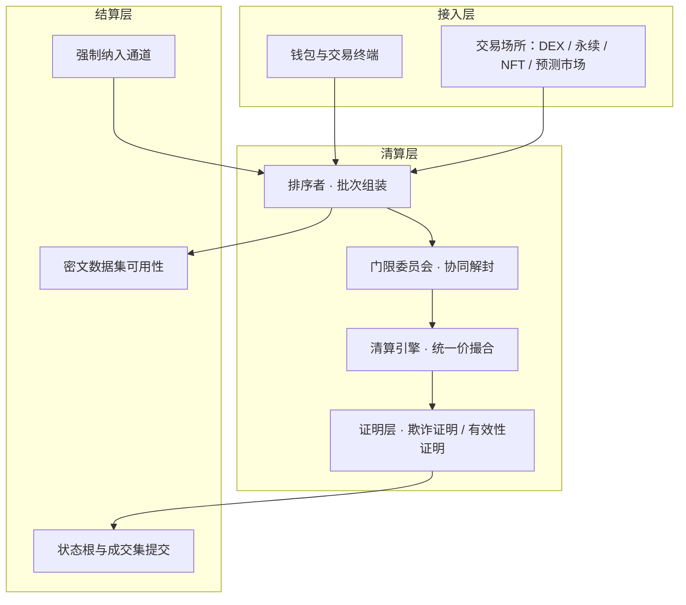

# KAIROS

**KAI · 链上统一价清算层**

*白皮书 v1.0 · 2026 年 10 月*

---

## 摘要

链上市场有一个从未被解决的缺陷：价格由到达顺序决定。

这个缺陷不是工程疏忽，而是规则的直接后果。只要先到的成交单能拿到更好的价格，抢先就有利可图；只要抢先有利可图，排序权就必然被定价、被拍卖、被垄断。过去十年间，行业用私有通道、加密内存池、排序权拍卖轮番尝试修复它，每一次都把提取权从一批人手里转移到另一批人手里，却从未让这笔生意消失。

KAIROS 换了一条路。

我们不隐藏订单，而是让排序变得毫无意义。所有订单在提交时被门限密码学封存，在一个固定长度的时间窗内累积成批；批次关闭后统一解封，全部成交按**同一个清算价**结算。

同批之内，排第一和排最后拿到的是同一个价格。抢先这项业务，从此失去了标的物。

KAIROS 由此提供三层能力：

- **SEAL** — 订单提交即封存，任何单一实体在批次关闭前都无法读取内容
- **BATCH** — 以 12 秒为周期的批次累积，把连续时间的速度竞赛转化为离散时点的集中撮合
- **CLEAR** — 统一价双向拍卖，批次内排序不产生任何经济价值

在此之上，KAIROS 是一个开放清算层：任何链上交易场所——现货、永续、NFT 拍卖、预测市场、借贷清算——都可以接入同一套封存与清算规则，共享同一份公平。

**KAI 是这套基础设施的结算与安全资产。**

---

## 一、为什么现在的市场是错的

### 1.1 速度税

以太坊主网的一笔普通兑换，从签名到上链平均要经过数百毫秒的公开内存池。在这段时间里，任何能看到它的人都可以做三件事：

1. 在你之前买入，推高价格，再卖给你；
2. 在你的清算交易之前抢先执行清算；
3. 把你的订单卖给出价最高的排序者。

这三件事构成了 MEV 的主要来源。它不创造任何价值，只是从普通用户口袋里把钱转移到拥有观察权和排序权的人手里。这是一笔纯粹的**速度税**。

### 1.2 修补的四个阶段

| 阶段 | 手段 | 结果 |
| --- | --- | --- |
| 2017–2019 | 公开内存池 + gas 竞价 | 抢跑公开化，gas 战争 |
| 2020–2022 | 私有中继、交易捆绑 | 泄漏从公开转为私有，中继成为新的信任点 |
| 2023–2025 | 提议者-构建者分离、区块空间拍卖 | 排序权被明码标价，提取权向少数构建者集中 |
| 2025–2026 | 订单流拍卖、意图导向架构 | 订单流本身成为可交易资产 |

四个阶段，同一条曲线：**提取权越来越集中，收费越来越制度化。**

每一次修补都假设同一个前提——排序决定收益，所以只能想办法让不该看见的人看不见。但信息总会泄漏：中继会看、构建者会看、解密会发生、订单流会被卖。泄漏只是被推迟，从未被消除。

### 1.3 问题的真正形状

把问题换个问法：

> 凭什么排序能换钱？

因为在连续竞价中，先到的单拿到更好的价格。价格随顺序变化，顺序就有价值。

那么，如果无论排第几都拿到同一个价格呢？

排序立刻一文不值。攻击者即便买通了排序者，插队也只能拿到和别人一样的成交价。**抢跑在协议层就没有了对手盘。**

这就是 KAIROS 的全部出发点。

---

## 二、KAIROS 的主张

### 2.1 三句话

**第一，不隐藏信息，消除信息的价值。**
隐藏是脆弱的，总有人能看到。消除价值是结构性的，看到了也无利可图。

**第二，把连续竞争改为离散清算。**
高频竞赛的本质是对微小时间差的争夺。当市场只在离散时点统一撮合，纳秒级优势归零。

**第三，公平优先于效率，但不牺牲可验证性。**
统一价牺牲了一部分价格发现能力。这个代价我们接受，并用可验证清算保证代价不是被暗箱放大的。

### 2.2 与主流方案的差异

| 方案 | 处理对象 | 结局 |
| --- | --- | --- |
| 私有交易通道 | 让订单不被看见 | 信任中继，泄漏私有化 |
| 加密内存池 | 让订单延后可见 | 解密后仍需排序，泄漏推迟 |
| PBS / 区块空间拍卖 | 让排序权市场化 | 提取权集中，寻租制度化 |
| **KAIROS** | **让排序不再有价值** | **排序权失去标的** |

前三者解决"看得见"，KAIROS 解决"看见了也没用"。

---

## 三、协议架构

### 3.1 分层



### 3.2 订单生命周期

```
构造    用户在本地生成 (方向, 价格档, 数量档)
封存    以系统公钥加密为密文，附提交保证金
提交    发送至排序者或直接广播
成批    批次关闭，密文集合锚定上链，保证数据可用
解封    委员会成员各自生成解密份额与零知识证明
合成    收集门限份额，恢复全部订单明文
清算    计算统一清算价与成交集，发布结果
证明    挑战期内可被任何人重算；异议触发罚没
结算    成交集写入结算层，状态最终确定
```

### 3.3 时间轴

```
t = 0            批次开启，接收密文订单
t = Δ            批次关闭，密文集合上链              Δ = 12s
t = Δ + 2s       解密份额收集完成                    门限 t-of-n
t = Δ + 4s       清算价与成交集发布
t = Δ + 4s + W   挑战期结束，状态最终确定            W = 30min（乐观） / 0（有效性证明）
```

`Δ = 12s` 是工程折中。更短则解封与带宽吃紧，更长则用户等待不可接受。该参数可在治理范围内调整，区间锁定在 6 秒至 60 秒。

---

## 四、SEAL：封存与解封

### 4.1 门限加密

KAIROS 采用门限 ElGamal，底层群取 BLS12-381 的 G1。

```
系统公钥    Y = g^y
私钥分片    y_i 为 y 的 Shamir 份额，门限 (t, n)
加密        (c1, c2) = (g^r, m · Y^r)          r 随机
解密份额    D_i = c1^{y_i}
份额校验    DLEQ 证明： log_g(Y_i) == log_{c1}(D_i)
合成        m = c2 / Π_{i∈S} D_i^{λ_i}         |S| = t，λ_i 为拉格朗日系数
```

系统参数为 `n = 128`，`t = 86`（三分之二加一）。任何单一实体、任何排序者、任何验证者都无法在批次关闭前读取订单内容。

**DLEQ 证明是协议的一部分，不是可选优化。** 缺少它，恶意成员可以提交任意份额使合成结果变成攻击者选定的值，而外部无法区分实现错误与蓄意作恶。有了它，错误份额可被任何人定位，罚没条件客观可判。

### 4.2 订单编码

ElGamal 的明文必须落在群上，而订单是整数元组。KAIROS 采用指数编码：

```
m = g^v
v 的位宽    40 bit
拆分为      方向 1 bit | 价格 20 bit | 数量 19 bit
求解方式    BSGS（baby-step giant-step）
复杂度      O(2^20) 步，内存约数百 MB
```

单批数千笔订单的离散对数求解可在秒级完成。20 位价格档约等于一百万档，对单一交易对的撮合精度完全够用。

### 4.3 密钥轮换

委员会每 `E = 100` 个批次换届一次，约 20 分钟。换届通过可验证秘密分享完成份额转移，主私钥全程不出现在任何单点。

轮换同时限制了单届委员会的作恶窗口。被渗透的委员会最多影响 `E` 个批次，随后份额作废。

### 4.4 保证金

| 角色 | 职能 | 质押 | 罚没条件 |
| --- | --- | --- | --- |
| 委员会成员 | 协同解封 | 固定额度 | 份额错误、明文泄漏、在线率不足 |
| 排序者 | 批次组装 | 按单批名义额比例 | 审查、错误清算、数据不可用 |
| 挑战者 | 提交欺诈证明 | 挑战保证金 | 恶意挑战，重算不符 |

---

## 五、CLEAR：统一价清算引擎

### 5.1 撮合规则

```
需求曲线    D(p) = Σ 买单数量，报价 ≥ p
供给曲线    S(p) = Σ 卖单数量，报价 ≤ p
清算价      p* = argmax_p  min( D(p), S(p) )
成交量      Q* = min( D(p*), S(p*) )
```

所有成交订单，无论报价高低，**一律按 p* 结算**。

### 5.2 一个算例

某批次订单如下。

买单：`@101 × 30`、`@100 × 50`、`@99 × 80`
卖单：`@97 × 40`、`@98 × 60`、`@100 × 70`

```
p = 100   →   D = 80     S = 100    min = 80
p = 99    →   D = 160    S = 100    min = 100
p = 98    →   D = 160    S = 160    min = 160     ← 最大
p = 97    →   D = 160    S = 200    min = 160
```

清算价 `p* = 98`，成交量 `Q* = 160`。

报价 101 的买单与报价 97 的卖单，成交价都是 98。没有人因为"报得更高"多赚，也没有人因为"来得更早"先成交。

### 5.3 排序无关性

设批次成交集合为 `O`，清算函数为 `Clear(·)`，`π` 为 `O` 上的任意置换：

```
Clear(O) = Clear(π(O))
```

在清算价、总成交量、各订单成交量三个维度上同时成立。

这是 KAIROS 的数学基础：**排序权在批次内不携带经济价值，因而不存在为排序付费的均衡。**

边界情形：多笔订单报价恰好等于 `p*` 且需要部分成交时，按订单哈希字典序分配，不按到达时间。规则写死在协议中，不留裁量空间。

### 5.4 并列清算价

`argmax` 不唯一时取最低的 `p*`。选择对买方有利的一侧，理由是卖方在本机制中拥有信息优势，更清楚自身持仓成本。

### 5.5 报价偏离保护

统一价拍卖存在一种特有攻击：提交远离市场的报价扭曲供需曲线。KAIROS 设置偏离保护带，报价被约束在最近三个批次加权均价的 ±20% 区间内。

---

## 六、SETTLE：结算与证明

### 6.1 乐观模式

清算结果连同解封后的完整订单集发布上链。挑战期 `W = 30min` 内，任何人可本地重算清算价与成交集。结果不一致则提交欺诈证明，罚没排序者与出错的委员会成员。

这一模式承载主网绝大部分流量，吞吐与成本最优。

### 6.2 有效性证明模式

将清算逻辑编译为电路，生成有效性证明，把最终性延迟压缩到零。

价格档位离散化为 4096 档，`argmax` 转换为 4096 个候选值中的最大值查找，电路规模可控。证明生成为秒级到十秒级。

有效性证明模式面向高价值批次：大宗交易、财库换仓、跨市场清算。两条路径长期并存，由接入方按批次规模自行选择。

### 6.3 数据可用性

密文集合必须完整上链。只提交承诺而不发布数据的协议，等于把全部验证权交给排序者一人。KAIROS 不接受这种取舍。

---

## 七、委员会与共识

### 7.1 选举

- 候选人需质押 KAI
- 每届按质押权重与历史在线率加权抽样
- 单一实体席位占比上限 5%，防止质押大户直接控盘
- 候选池按司法辖区与基础设施分布做准入审查

### 7.2 合谋的边界

`t` 个成员合谋可以提前获知清算价 `p*`，从而在其他交易场所抢先交易。

这是密封竞价机制的固有残余风险，KAIROS 通过三个杠杆压缩它，而不是宣称消除：

1. **扩大 n** — 128 个席位意味着收买门槛是 86 个独立主体
2. **缩短轮换周期** — 单届影响窗口锁定在 100 个批次之内
3. **限制单批名义额** — 直接压低单批可提取价值的上限

三条同时启用。单批名义额上限是最有效的一条，也是对大宗交易最不友好的一条，KAIROS 选择牺牲这部分吞吐来换取安全性。

### 7.3 罚没条件

| 条件 | 判定方式 |
| --- | --- |
| 提交错误解密份额 | DLEQ 验证失败，链上客观可判 |
| 在线率低于阈值 | 链上心跳统计 |
| 排序者审查 | 强制纳入超时，链上客观可判 |
| 错误清算 | 欺诈证明重算不符，链上客观可判 |
| 泄漏明文 | 链下取证配合链上投票 |

---

## 八、强制纳入

排序者可以拒绝某笔订单。协议必须提供不依赖其善意的不合作出口。

```
1. 用户将订单哈希与保证金提交至结算层 forceInclude 合约
2. 若 k 个批次内该订单未出现在任何批次的密文集合中，审查成立
3. 排序者罚没，订单进入强制纳入队列，下一批必须包含
4. 拒绝持续则罚没累加，直至经济上不可持续
```

这是抗审查的唯一保证来源。没有它，任何"去中心化排序"的说法都不成立。

强制纳入会公开订单哈希，因而部分牺牲保密性。抗审查与保密性之间存在真实张力，KAIROS 的选择是：**抗审查不可让渡，保密性在必要时刻可以让位。**

---

## 九、KAI 代币经济

### 9.1 总量与分配

**总量 1,000,000,000 KAI，不增发。**

| 类别 | 占比 | 数量 | 释放规则 |
| --- | --- | --- | --- |
| 生态与清算激励 | 35% | 350,000,000 | 4 年线性，按季度释放 |
| 团队与贡献者 | 20% | 200,000,000 | 12 个月锁仓 + 36 个月线性 |
| 早期支持者 | 15% | 150,000,000 | 12 个月锁仓 + 24 个月线性 |
| 协议金库 | 15% | 150,000,000 | 治理控制，无固定释放 |
| 初始流动性 | 10% | 100,000,000 | 上线时全额解锁 |
| 委员会引导池 | 5% | 50,000,000 | 用于主网初期席位激励，18 个月释放 |

### 9.2 价值来源

KAI 的价值来自三个真实需求，而非叙事：

**第一，安全预算。** 委员会与排序者必须质押 KAI，质押规模决定了协议能承受的在险价值。协议承载的名义成交额越大，需要的质押规模越大。

**第二，费用消耗。** 每笔成交按名义额收取 0.02% 的手续费，其中 50% 直接销毁。销毁量与协议真实使用量线性挂钩。

**第三，治理权。** 参数调整、金库支出、委员会准入标准，均由 KAI 质押者投票决定。

### 9.3 费用分配

```
50%   销毁
40%   委员会与排序者按质押权重分配
10%   保险金库，用于清算错误赔付
```

费用按名义额计提，不按笔收取。按笔收费会惩罚小额用户，而小额用户恰恰是最需要抗抢跑保护的群体。

### 9.4 质押收益

质押收益完全来自手续费分成，没有增发补贴。这意味着收益率由协议真实使用量决定，而不是由白皮书承诺。

```
年化收益率 ≈ (年化手续费收入 × 40%) / 质押总市值
```

主网初期的收益率会显著高于稳态，随着质押规模上升而下降。这是设计意图，不是缺陷：早期需要激励吸引质押，后期由真实费用支撑。

### 9.5 不做什么

KAI 不用于手续费折扣，不用于流动性挖矿，不用于生态空投。

折扣会诱导囤积而非使用；挖矿奖励会制造虚假需求；空投会制造无差别抛压。这三件事都能让市值曲线在短期内好看，代价是把代币变成纯粹的投机工具。

---

## 十、生态与应用

KAIROS 的清算层对任何交易场所开放。以下五类场景是主网首年的主攻方向。

### 10.1 现货兑换

DEX 接入 KAIROS 后，用户提交的兑换订单进入密封批次，按统一价成交。做市商的库存管理从"防守抢跑"变成"预测成交量"，资本效率显著提升。

### 10.2 大宗交易

机构建仓最大的成本不是手续费，而是被跟踪。密封批次让"这一批里有大单"可见，而"大单在哪一侧、多大"不可见，且成交价与散户完全相同。

### 10.3 DAO 财库换仓

财库操作历来是狙击的重灾区。治理决议到执行之间的时间窗口可被完全预测。统一价拍卖把这个窗口从可被利用变成无利可图。

### 10.4 借贷清算

清算交易集中在少数区块，本身是公开的套利目标。批处理把同批内的所有清算按统一价处理，消除了"谁的清算先被打"的竞争，清算奖励回归为风险承担的报酬。

### 10.5 预言机与预测市场

预测市场的结算涉及大量同时对冲，且高度集中在事件落地时刻。统一价清算消除了事件前最后一秒的速度竞赛。

---

## 十一、治理

KAIROS 的治理遵循一条原则：**治理可以优化参数，不能取消保证。**

**提案权**：持有 0.5% 以上 KAI，或连续三个月活跃使用的地址联合署名。

**投票周期**：7 天投票，48 小时时间锁。

**可调参数**：批次长度、费用率、单批名义额上限、委员会规模、质押要求、偏离保护带宽。

**不可调参数**：挑战期不得取消、强制纳入不得关闭、排序无关性规则不得修改、密文数据集可用性要求不得降低。

把一部分参数设为不可变，是为了防止治理本身成为攻击面。一个可以通过投票取消抗审查保证的协议，实际上没有抗审查保证。

---

## 十二、路线图

| 阶段 | 时间 | 交付 |
| --- | --- | --- |
| 测试网 | 2026 Q4 | 单市场封存与清算、乐观证明、强制纳入 |
| 主网 Alpha | 2027 Q1 | 单市场上线、委员会引导、KAI 发行与质押 |
| 主网 Beta | 2027 Q2 | 多市场并行、委员会轮换、审计报告公开 |
| 主网 v1 | 2027 Q3 | 有效性证明模式、跨市场清算、治理上线 |
| 清算联盟 | 2028 | 向第三方交易场所开放接入，共享清算层 |

各阶段交付以代码仓库的实际提交为准。路线图是工程计划，不是承诺。

---

## 十三、贡献者

KAIROS 由一群长期研究市场微观结构与链上密码学的工程师发起。核心团队以化名参与，这在密码朋克传统中有其合理性：协议的安全性应当由代码与数学保证，而不是由创始人履历保证。

贡献分为三类：

- **协议研究** — 清算机制、密码学构造、博弈分析
- **核心开发** — 客户端、电路、合约、委员会节点
- **生态集成** — 交易场所接入、钱包支持、开发者工具

所有核心代码以开源协议发布，贡献记录在公开仓库中可查。任何人的加入与退出都不影响协议运转，这是 KAIROS 对"去中心化"的具体定义：不是没有团队，而是团队不是单点。

---

## 十四、风险

**流动性碎片化。** 统一价拍卖在对手盘不足时无法产生有效清算价。低流动性交易对在 KAIROS 上可能长期无法成交，这类资产不适合接入。

**价格发现能力下降。** 大额订单无法通过提高报价优先成交，只能等待批量匹配。这是用效率换公平的直接代价。

**延迟。** 端到端延迟在 16 秒以上。对高频策略基本不可用，KAIROS 也不以这类用户为目标。

**委员会信任假设。** 门限委员会由 128 个独立主体组成，但仍是信任假设而非无信任系统。合谋风险通过经济与结构手段压缩，无法归零。

**跨链资产依赖桥。** 桥接资产的安全由桥承担，KAIROS 无法消除其风险。

**监管环境变化。** 各司法辖区对加密资产与交易服务的监管持续演变，可能影响协议在部分地区的可用性。

---

## 参考

1. Daian, P. et al. *Flash Boys 2.0: Frontrunning in Decentralized Exchanges, Miner Extractable Value, and Consensus Instability.* IEEE S&P, 2020.
2. Budish, E., Cramton, P., Shim, J. *The High-Frequency Trading Arms Race: Frequent Batch Auctions as a Market Design Response.* QJE, 2015.
3. Shamir, A. *How to Share a Secret.* Communications of the ACM, 1979.
4. Wilson, R. *Nonlinear Pricing.* Oxford University Press, 1993.
5. Buterin, V. *Proposer/Builder Separation.* 2021–2023.

---

<div class="whitepaper-footer" markdown>

*本文档仅供技术研究与讨论使用，不构成任何司法辖区内的证券发行、投资邀约或收益承诺。数字资产价格波动剧烈，参与前请自行评估风险。*

</div>
