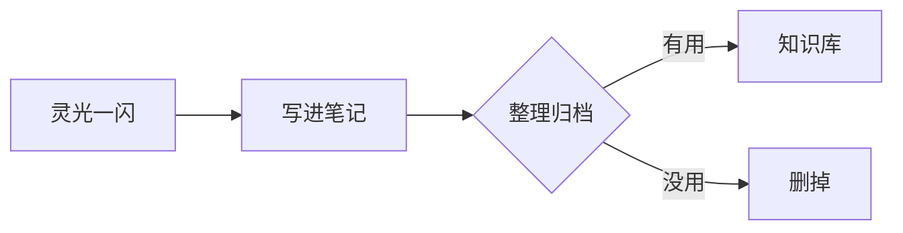

# Knowledge

个人知识库 —— 笔记、文档与随手记。

---

## 从这里开始

<div class="grid cards" markdown>

-   :material-notebook-outline:{ .lg .middle } **笔记**

    ---

    技术笔记、踩坑记录、命令速查。

    [:octicons-arrow-right-24: 待补充](#)

-   :material-file-document-outline:{ .lg .middle } **文档**

    ---

    项目文档、方案设计、部署手册。

    [:octicons-arrow-right-24: 待补充](#)

-   :material-lightbulb-outline:{ .lg .middle } **随手记**

    ---

    灵感、待办、临时记录。

    [:octicons-arrow-right-24: 待补充](#)

</div>

---

## 这个站点怎么用

本站用 [MkDocs](https://www.mkdocs.org/) 加 [Material for MkDocs](https://squidfunk.github.io/mkdocs-material/) 搭的，
源文件就是仓库里的 Markdown。

| 操作 | 命令 |
| --- | --- |
| 本地预览 | `mkdocs serve` |
| 构建静态站点 | `mkdocs build` |
| 发布到 GitHub Pages | `mkdocs gh-deploy` |

推送到 `main` 分支后，GitHub Actions 会自动构建部署。

### 新建一页

1. 在 `docs/` 下建一个 `.md` 文件，比如 `docs/linux/nginx.md`
2. 打开 `mkdocs.yml`，在 `nav:` 里登记：

    ```yaml
    nav:
      - 首页: index.md
      - Linux:
          - Nginx: linux/nginx.md
    ```

3. 保存后本地预览会自动刷新

---

## 支持的写法

!!! tip "提示框"
    用 `!!! tip` 开头，缩进四个空格写内容。
    可用类型：`note` `tip` `info` `warning` `danger` `example` `quote` `success` `failure`

!!! warning "注意"
    `mkdocs.yml` 里没登记的页面**不会**出现在导航栏，但直接访问链接仍然可达。

??? note "折叠块（点击展开）"
    用 `???` 代替 `!!!` 就是默认折叠，用 `???+` 是默认展开。

代码块带复制按钮和行号高亮：

```python title="example.py" hl_lines="2"
def greet(name: str) -> str:
    return f"你好，{name}！"

print(greet("世界"))
```

Mermaid 图表：



任务列表：

- [x] 搭好 MkDocs Material
- [x] 接上 GitHub Actions 自动部署
- [ ] 把笔记搬进来
- [ ] 开启 GitHub Pages

键盘按键：++ctrl+c++ 、++cmd+shift+p++
