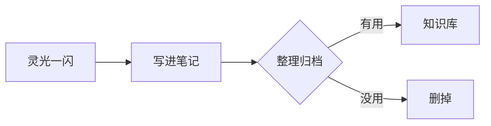

# Knowledge

个人知识库 —— 笔记、文档与随手记。

---

## 从这里开始

<div class="grid cards" markdown>

-   :material-key-variant:{ .lg .middle } **API 与账号**

    ---

    API 账户查询、凭据管理与集成踩坑。

    [:octicons-arrow-right-24: DeepSeek 余额与用量查询](api/deepseek-account-balance.md)

-   :material-server-network:{ .lg .middle } **网络与穿透**

    ---

    frp vhost、SNI/TLS 透传、内网服务发布。

    [:octicons-arrow-right-24: frp vhost 与 SNI 透传](frp/vhost-sni-tls.md)

-   :material-cog-outline:{ .lg .middle } **工程实践**

    ---

    文档站流水线、CI、工具链踩坑。

    [:octicons-arrow-right-24: MkDocs × GitHub Actions](devops/mkdocs-github-actions.md) ·
    [:octicons-arrow-right-24: 受限网络下部署 Hermes](devops/hermes-remote-deploy.md)

-   :material-bank-outline:{ .lg .middle } **银行卡与开户**

    ---

    香港四家银行开户条件、文件清单与费用对比。

    [:octicons-arrow-right-24: 香港银行开户总览](banking/hk-banks-overview.md) ·
    [:octicons-arrow-right-24: 中银香港](banking/bochk-hk-account.md) ·
    [:octicons-arrow-right-24: 汇丰香港](banking/hsbc-hk-account.md)

    [:octicons-arrow-right-24: 工银亚洲](banking/icbc-asia-account.md) ·
    [:octicons-arrow-right-24: 恒生银行](banking/hang-seng-hk-account.md)

-   :material-file-certificate-outline:{ .lg .middle } **税务与公司**

    ---

    税号申请、境外公司注册与年成本。

    [:octicons-arrow-right-24: 美国 ITIN](tax/itin-us.md) ·
    [:octicons-arrow-right-24: 英国公司成本](tax/uk-company-cost.md) ·
    [:octicons-arrow-right-24: 马来西亚 TIN](tax/malaysia-tin.md)

</div>

---

## 这个站点怎么用

本站用 [MkDocs](https://www.mkdocs.org/) 加 [Material for MkDocs](https://squidfunk.github.io/mkdocs-material/) 搭的，
源文件就是仓库里的 Markdown。

| 操作 | 命令 |
| --- | --- |
| 本地预览 | `mkdocs serve` |
| 构建静态站点 | `mkdocs build` |
| 发布到 GitHub Pages | `mkdocs gh-deploy` |

推送到 `main` 分支后，GitHub Actions 会自动构建部署。

### 新建一页

1. 在 `docs/` 下建一个 `.md` 文件，比如 `docs/linux/nginx.md`
2. 打开 `mkdocs.yml`，在 `nav:` 里登记：

    ```yaml
    nav:
      - 首页: index.md
      - Linux:
          - Nginx: linux/nginx.md
    ```

3. 保存后本地预览会自动刷新

---

## 支持的写法

!!! tip "提示框"
    用 `!!! tip` 开头，缩进四个空格写内容。
    可用类型：`note` `tip` `info` `warning` `danger` `example` `quote` `success` `failure`

!!! warning "注意"
    `mkdocs.yml` 里没登记的页面**不会**出现在导航栏，但直接访问链接仍然可达。

??? note "折叠块（点击展开）"
    用 `???` 代替 `!!!` 就是默认折叠，用 `???+` 是默认展开。

代码块带复制按钮和行号高亮：

```python title="example.py" hl_lines="2"
def greet(name: str) -> str:
    return f"你好，{name}！"

print(greet("世界"))
```

Mermaid 图表：



任务列表：

- [x] 搭好 MkDocs Material
- [x] 接上 GitHub Actions 自动部署
- [ ] 把笔记搬进来
- [ ] 开启 GitHub Pages

键盘按键：++ctrl+c++ 、++cmd+shift+p++
