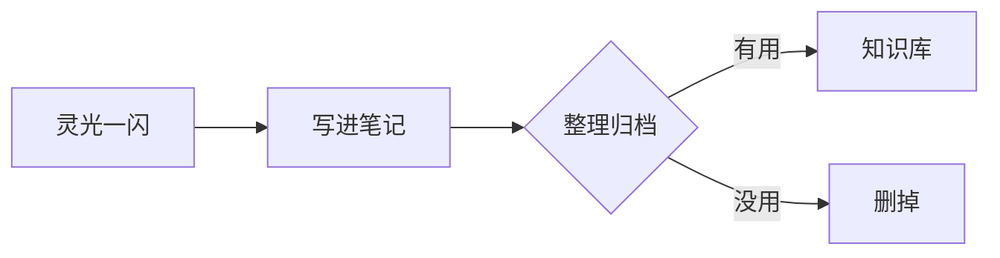

# Knowledge

个人知识库 —— 笔记、文档与随手记。

---

<!-- UPDATES:START -->

## 最近更新

_按提交时间从新到旧，自动生成。想看全部改动就翻 [commit 历史](https://github.com/XiHuu/Knowledge/commits/main)。_

| 日期 | 页面 | 变更 |
| --- | --- | --- |
| 2026-10-23 | [BATCH：密封竞价批处理清算层](crypto/batch-sealed-auction.md) | BATCH 白皮书 v1.0——补完代币经济、安全模型、形式化不变式与风险披露 |
| 2026-10-23 | [BATCH：密封竞价批处理清算层](crypto/batch-sealed-auction.md) | BATCH 密封竞价批处理清算层 · 技术白皮书草案 v0.1 |
| 2026-10-23 | [适马 fp → fp2：六年后换掉了什么](gear/sigma-fp2.md) | 适马 fp → fp2 升级对比 |
| 2026-10-20 | [美国 ITIN（个人纳税人识别号）](tax/itin-us.md) · [有了 ITIN 之后：1040-NR 的「零申报」到底怎么做](tax/us-zero-return.md) | 新增「有了 ITIN 之后：1040-NR 的零申报到底怎么做」 |
| 2026-10-19 | [成为 AS operator：自持 ASN、自有 IP 段、自己跑 BGP](network/as-operator.md) | 新增「成为 AS operator：自持 ASN、自有 IP 段、自己跑 BGP」 |
| 2026-10-19 | [德国税号：010250 表到底是什么，人在国内能不能用](tax/germany-tax-id.md) | 德国税号页补「个人税号」这一节的真相 |
| 2026-10-19 | [德国税号：010250 表到底是什么，人在国内能不能用](tax/germany-tax-id.md) | 新增「德国税号：010250 表到底是什么，人在国内能不能用」 |
| 2026-10-17 | [卡组织与卡等级体系（银联 / Visa / 万事达 / 美国运通）](banking/card-network-tiers.md) | 卡等级页补 Luhn 校验函数与实测检出边界 |
| 2026-10-17 | [卡组织与卡等级体系（银联 / Visa / 万事达 / 美国运通）](banking/card-network-tiers.md) | 卡等级页补「卡号结构：BIN + Luhn 校验位」 |
| 2026-10-17 | [玩卡圈的常用站点](banking/card-community-sites.md) · [卡组织与卡等级体系（银联 / Visa / 万事达 / 美国运通）](banking/card-network-tiers.md) · 等 3 页 | 新增「玩卡圈常用站点」 |
| 2026-10-16 | [卡组织与卡等级体系（银联 / Visa / 万事达 / 美国运通）](banking/card-network-tiers.md) · [银行卡与开户](banking/index.md) · 等 3 页 | 新增「卡组织与卡等级体系」，并修掉中文锚点从不生效的坑 |
| 2026-10-16 | [建行 龙卡 bilibili 信用卡（学生版）](banking/mainland/ccb-bilibili-campus.md) | 建行 bilibili 学生版页去掉纠错分析和对比，恢复成纯介绍卡 |
| 2026-10-16 | [建行 龙卡 bilibili 信用卡（学生版）](banking/mainland/ccb-bilibili-campus.md) · [学生信用卡总览（中国大陆 · 0 门槛 / 0 年费）](banking/mainland/student-cards-overview.md) | 建行 bilibili 学生版换成真正的金卡(Gold)现行卡面 2233星月学生版 |
| 2026-10-16 | [建行 龙卡 bilibili 信用卡（学生版）](banking/mainland/ccb-bilibili-campus.md) | 建行 bilibili 页「停发」读错对象 —— 停的是卡面，学生版未停发 |
| 2026-10-16 | [建行 龙卡 bilibili 信用卡（学生版）](banking/mainland/ccb-bilibili-campus.md) | 建行 bilibili 学生版页放错卡等级 —— 换成金卡(Gold)，标准版(Platinum)单独标注 |
| 2026-10-16 | [中国银行 哔哩哔哩 2233 联名借记卡（万事达 223300）](banking/mainland/boc-bilibili-2233.md) · [中行 长城无界青春卡校园版](banking/mainland/boc-greatwall-campus.md) · 等 9 页 | 给所有介绍卡的页面补上真实卡面 |
| 2026-10-16 | [中银香港（BOCHK）开户指南](banking/hk/bochk-hk-account.md) · [恒生银行（香港）开户条件](banking/hk/hang-seng-hk-account.md) · 等 13 页 | 新增 iFAST 英国开户与 4 张境内外通用借记卡，并给开户教程配官方图 |
| 2026-10-16 | [海外银行卡与信用卡](banking/overseas/index.md) | 信用卡并入「银行卡与开户」，按地区分子目录 |
| 2026-10-16 | [DeepSeek API 账户余额与用量查询](api/deepseek-account-balance.md) | 新增 DeepSeek 余额查询方法；补全首页卡片 |
| 2026-10-16 | [在受限网络下部署 Hermes（中国大陆场景）](devops/hermes-remote-deploy.md) | 修正克隆测速方法论 —— 必须测对模式，且单次数据不可信 |
| 2026-10-16 | [在受限网络下部署 Hermes（中国大陆场景）](devops/hermes-remote-deploy.md) | 补全 GitHub 镜像实测表（ghproxy.net / hub.nuaa.cf） |
| 2026-10-16 | [在受限网络下部署 Hermes（中国大陆场景）](devops/hermes-remote-deploy.md) | 新增《受限网络下部署 Hermes》 |
| 2026-10-16 | [MkDocs Material × GitHub Actions：构建、推分支、rsync 到服务器](devops/mkdocs-github-actions.md) · [frp vhost：基于 Host / SNI 的内网穿透](frp/vhost-sni-tls.md) · 等 5 页 | 建立知识库结构，收录 frp / CI / 开户 / 税务 六篇 |

<!-- UPDATES:END -->

## 从这里开始

<div class="grid cards" markdown>

-   :material-key-variant:{ .lg .middle } **API 与账号**

    ---

    API 账户查询、凭据管理与集成踩坑。

    [:octicons-arrow-right-24: DeepSeek 余额与用量查询](api/deepseek-account-balance.md)

-   :material-server-network:{ .lg .middle } **网络与穿透**

    ---

    frp vhost、SNI/TLS 透传、内网服务发布。

    [:octicons-arrow-right-24: frp vhost 与 SNI 透传](frp/vhost-sni-tls.md)

-   :material-cog-outline:{ .lg .middle } **工程实践**

    ---

    文档站流水线、CI、工具链踩坑。

    [:octicons-arrow-right-24: MkDocs × GitHub Actions](devops/mkdocs-github-actions.md) ·
    [:octicons-arrow-right-24: 受限网络下部署 Hermes](devops/hermes-remote-deploy.md)

-   :material-bank-outline:{ .lg .middle } **银行卡与开户**

    ---

    按地区分：中国大陆（学生信用卡 + 境内外通用借记卡）、香港银行开户、海外银行卡。

    **中国大陆 · 学生信用卡（0 门槛）**

    [:octicons-arrow-right-24: 学生信用卡总览](banking/mainland/student-cards-overview.md) ·
    [:octicons-arrow-right-24: 工行星座卡校园版](banking/mainland/icbc-constellation-campus.md)

    [:octicons-arrow-right-24: 建行 bilibili 学生版](banking/mainland/ccb-bilibili-campus.md) ·
    [:octicons-arrow-right-24: 中行长城无界青春卡](banking/mainland/boc-greatwall-campus.md) ·
    [:octicons-arrow-right-24: 中信校园 i 卡](banking/mainland/citic-campus-i.md)

    [:octicons-arrow-right-24: 招行 Young 卡](banking/mainland/cmb-young-campus.md) ·
    [:octicons-arrow-right-24: 交行校园卡（已停发）](banking/mainland/bocom-campus-card.md) ·
    [:octicons-arrow-right-24: 其他银行与停发清单](banking/mainland/other-student-cards.md)

    **中国大陆 · 境内外通用借记卡**

    [:octicons-arrow-right-24: 招行万事达 IC 借记卡](banking/mainland/cmb-mastercard.md) ·
    [:octicons-arrow-right-24: 中信运通人民币借记卡](banking/mainland/citic-amex-debit.md)

    [:octicons-arrow-right-24: 中行 bilibili 2233 借记卡](banking/mainland/boc-bilibili-2233.md) ·
    [:octicons-arrow-right-24: 招行 bilibili 花嫁储蓄卡](banking/mainland/cmb-bilibili-card.md)

    **香港**

    [:octicons-arrow-right-24: 香港银行开户总览](banking/hk/hk-banks-overview.md) ·
    [:octicons-arrow-right-24: 中银香港](banking/hk/bochk-hk-account.md) ·
    [:octicons-arrow-right-24: 汇丰香港](banking/hk/hsbc-hk-account.md)

    [:octicons-arrow-right-24: 工银亚洲](banking/hk/icbc-asia-account.md) ·
    [:octicons-arrow-right-24: 恒生银行](banking/hk/hang-seng-hk-account.md)

    **海外**

    [:octicons-arrow-right-24: iFAST Global Bank（英国）](banking/overseas/ifast-global-bank.md) ·
    [:octicons-arrow-right-24: 海外目录](banking/overseas/index.md)

-   :material-file-certificate-outline:{ .lg .middle } **税务与公司**

    ---

    税号申请、境外公司注册与年成本。

    [:octicons-arrow-right-24: 美国 ITIN](tax/itin-us.md) ·
    [:octicons-arrow-right-24: 英国公司成本](tax/uk-company-cost.md) ·
    [:octicons-arrow-right-24: 马来西亚 TIN](tax/malaysia-tin.md)

-   :material-cube-outline:{ .lg .middle } **区块链与协议设计**

    ---

    链上机制设计、密码学构造与白皮书。

    [:octicons-arrow-right-24: BATCH：密封竞价批处理清算层](crypto/batch-sealed-auction.md)

-   :material-camera-outline:{ .lg .middle } **摄影器材**

    ---

    相机、镜头与器材对比。

    [:octicons-arrow-right-24: 适马 fp → fp2 升级对比](gear/sigma-fp2.md)

</div>

---

## 这个站点怎么用

本站用 [MkDocs](https://www.mkdocs.org/) 加 [Material for MkDocs](https://squidfunk.github.io/mkdocs-material/) 搭的，
源文件就是仓库里的 Markdown。

| 操作 | 命令 |
| --- | --- |
| 本地预览 | `mkdocs serve` |
| 构建静态站点 | `mkdocs build` |
| 发布到 GitHub Pages | `mkdocs gh-deploy` |

推送到 `main` 分支后，GitHub Actions 会自动构建部署。

### 新建一页

1. 在 `docs/` 下建一个 `.md` 文件，比如 `docs/linux/nginx.md`
2. 打开 `mkdocs.yml`，在 `nav:` 里登记：

    ```yaml
    nav:
      - 首页: index.md
      - Linux:
          - Nginx: linux/nginx.md
    ```

3. 保存后本地预览会自动刷新

---

## 支持的写法

!!! tip "提示框"
    用 `!!! tip` 开头，缩进四个空格写内容。
    可用类型：`note` `tip` `info` `warning` `danger` `example` `quote` `success` `failure`

!!! warning "注意"
    `mkdocs.yml` 里没登记的页面**不会**出现在导航栏，但直接访问链接仍然可达。

??? note "折叠块（点击展开）"
    用 `???` 代替 `!!!` 就是默认折叠，用 `???+` 是默认展开。

代码块带复制按钮和行号高亮：

```python title="example.py" hl_lines="2"
def greet(name: str) -> str:
    return f"你好，{name}！"

print(greet("世界"))
```

Mermaid 图表：



任务列表：

- [x] 搭好 MkDocs Material
- [x] 接上 GitHub Actions 自动部署
- [ ] 把笔记搬进来
- [ ] 开启 GitHub Pages

键盘按键：++ctrl+c++ 、++cmd+shift+p++
